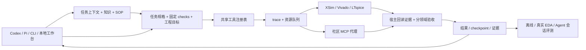
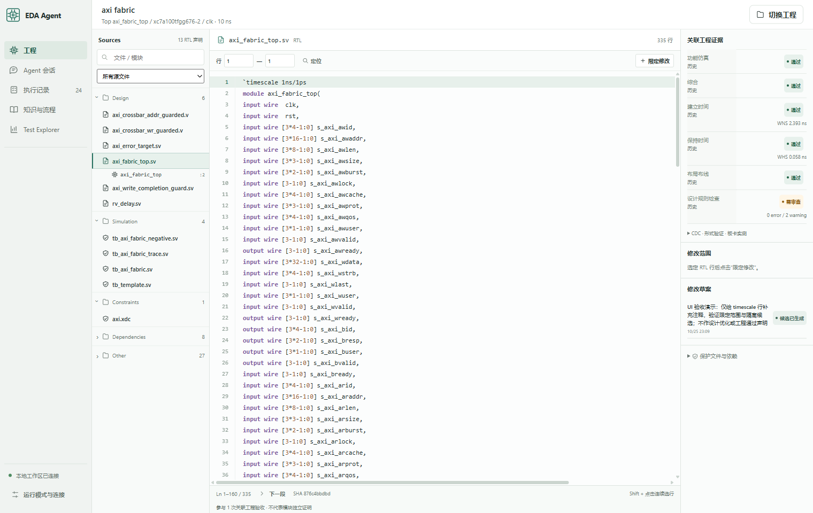

# Native EDA Agent

面向本机 Vivado / FPGA 开发的 Agent 工程：通过 Codex、Pi 或 CLI 检索设计知识、读取 SOP、组织仿真与实现任务，并核验和恢复执行证据。模拟电路侧提供 LTspice 批处理与测量验收。

[A7-100T 的 8 项完整工程验收](docs/a7-eight-projects.md) **8/8 通过**：SoC、DMA、UDP、AES、AXI 3×3、三时钟 Ethernet、AES DMA SoC 和 FFT；[复跑入口与器件级边界](projects/a7-validation/README.md)。7/7 Pi 会话通过在线证据复核；301 项离线软件测试通过。

[两项从零 RTL 续修](docs/rtl-repair-2026-10-27.md)：DMA 与 4×4 包交换机的固定工程验收、原生 Pi 交付和独立在线评测均为 **2/2 通过**。提供通过 RTL、原始空壳、固定测试与失败记录；首次 verifier 0/2 和上一批未完成成绩保持独立。当前离线软件检查 **310 项通过**。

当前重点是 **可追溯的知识指导、固定验收、可靠执行和结果复核**。模型提供商 API 默认关闭；下列本地工具和离线检查不需要模型 API key。

[任务闭环](docs/agent-lifecycle.md) · [稳定性实测](docs/stability-2026-10-26.md) · [NVIDIA 反馈接入](docs/ace-rtl-adaptation.md) · [工程工作台](docs/workbench-v08.md) · [分类评测](docs/evaluation.md) · [核心机制](docs/mechanisms.md) · [RAG 与 SOP](docs/knowledge-and-sops.md) · [功能成绩](docs/results.md) · [仓库结构](docs/repository-layout.md) · [全部文档](docs/README.md)

## 项目亮点

- **知识直接进入任务**：36 条规则带来源、版本、适用条件与所需证据；中英文检索有排名；6 个 SOP 同时支持 Pi 发现和 MCP 读取。workflow 固定所选知识与 SOP 的文件哈希。
- **验收条件可执行**：任务声明输入、前序结果引用、逐步 checks、工程目标 profile 和累计预算；宿主重新读取证据，核验顶层、器件、时钟与 DCP 来源。工具完成、功能通过、时序通过、CDC/DRC 和上板分别判断。
- **生成与验证形成闭环**：同一 Pi 会话修复限定 RTL，宿主按固定 workflow 独立验收，失败后接收 NVIDIA ACE-RTL 原版反馈并复验。输入漂移、停滞、取消与累计预算均可停止循环；会话完成与工程通过独立记录。
- **候选、恢复和交付连通**：自动复制声明的依赖并固定可编辑 RTL，工具调用受范围约束；每轮按失败域检索规则和 SOP。已提交的取消回合可跨会话续跑，验证额度累计；最终回答由重新检查的证据生成。
- **模型执行有明确边界**：普通与嵌套工具共用会话预算；取消后在下一次模型请求前停止派发；SDK codemode 关闭额外分类/图像模型入口。离线测试会话有明确来源，线上评测拒收注入或来源未知的记录。
- **任务可追踪和恢复**：每次调用保留输入快照、进程、失败、终态与因果 trace。恢复前核验所有者、输入、代码和产物；在新目录从已提交边界继续；同一恢复链重复三次失败后停止重放并要求诊断。
- **EDA 执行受资源约束**：原生工具与社区 MCP 代理共享资源租约，支持队列、超时与取消。物理优化器另有候选准入、最佳结果保留、停滞停止和最终复测。
- **会话驱动的工程工作台**：保存、查找、重命名与归档会话，在对话中准备工程任务、审阅固定计划、执行、取消并查看证据。任务、运行和事件持久化；离线、真实 EDA、Agent 会话评测分别记录。
- **RTL 工程表盘与限定修改**：项目清单关联源码、模块声明、测试台、约束和分领域验证；选择具体 RTL 行范围，冻结输入、预览差异，再生成隔离的源码候选。约束、测试台、依赖和范围外内容保留原始哈希。
- **逐例测试视图**：软件机制、检索、工具案例、工程领域、真实 Agent 任务使用独立分母；按类别、难度和结果筛选，展开失败原因与历史证据。未运行、预期失败、当前源码变化明确保留。
- **成绩可以复核**：保留原测试协议、失败和公开证据哈希。不同题集、watchdog 和计分单位不合并成总分。

## 按功能看能力与证据

| 功能 | 已有能力与证据 | 验收范围 |
|---|---|---|
| RTL 功能验证 | XSim 固定 checker、参数/种子/背压/复位；24 题原协议 20/24，延长 watchdog 的同一批 RTL 为 23/24 | 可见测试；两种协议分开，非盲测 pass@1 |
| 从零 RTL 生成与修复 | DMA / 4×4 包交换机续修后工程与原生交付均 2/2 | 可见固定 checker，有诊断辅助；首次 verifier 0/2；[完整记录](docs/rtl-repair-2026-10-27.md) |
| 系统工程集成 | FFT 1024 点、16 帧；SoC/DMA/UDP/AES 4/4；AXI 3×3、三时钟 Ethernet、RV32IM AES DMA 3/3 | 功能与 OOC 实现；Ethernet 保留 34 条 CDC warning |
| 综合、实现与诊断 | 显式 RTL/XDC/DCP 输入，setup/hold、约束、routing、CDC、网表对象查询；原生集成检查 12/12 | 报告诊断；缺失字段保留 unknown；无板级签核 |
| 工程、IP、Block Design | 社区 Workbench 13 类操作，33/33 工具检查 | 工具集成检查，非 33 个新 FPGA 项目 |
| 物理优化 | 7 个本地策略、准入与复测；历史 AXI 运行 2 个候选，实测 WNS 收益 0 ns | 仅其中 2 类 reroute 有实跑；未复现竞赛排名 |
| 模拟电路 | LTspice RC AC/瞬态、独立解析解校验；历史四项测量误差均低于固定 0.2% 阈值 | RC 基础案例；新代理版本未重跑商业工具 |
| 知识与 SOP | 36 规则 / 21 来源 / 6 SOP；24 条可见检索回归 Hit@5 为 24/24 | 检索相关性；不是回答正确率或设计通过率 |
| Agent 工程机制 | 输入/知识冻结、预算、恢复、MCP、资源并发、trace、真实 Pi 资源加载等 310 项离线检查 | 假 EDA、本机进程与协议验收；当前回执见 release/validation-rtl-repair.json 和 CI |
| 独立 verifier 闭环 | 原生 Pi / CommandCode 与宿主 verifier；7/7 最终会话通过在线证据复核 | 已知工程集成与框架修复，保留此前失败；[A7 最终验收](docs/a7-eight-projects.md)与[前期定向修复](docs/stability-2026-10-26.md)分别记分 |

详细协议、失败、资源和证据索引见 [功能成绩](docs/results.md)。历史 11 组成绩保持原协议；Counter、真实 DRC 查询和完整 AXI 结果单列于功能成绩。接口数量单列在 [工具合同](docs/reference/tools.md)：57 个原生入口，其中 28 个为共享执行器的细粒度合同；可选社区后端另有 45 个工具与 11 个 prompts。

## 架构



验证任务会按实际失败域自动检索 RAG/SOP，普通探索会话仍可按需调用知识工具。宿主执行固定参数、预算、检查与恢复条件；模型负责分析、查阅和修复。Pi 会话与 CLI 共用驱动，支持会话续接和公开事件。仓库默认关闭模型 API；授权后在本机配置提供商。原生 Pi 1.4、CommandCode 与真实 XSim/Vivado 的限定实测见 [稳定性记录](docs/stability-2026-10-26.md)。向量索引、自动答案引用核验与强沙箱尚未提供。

可选 [ACE-RTL 验证循环](docs/ace-rtl-adaptation.md) 已接入同一 Pi 会话：候选 RTL → 固定工程验收 → NVIDIA 原版反馈组件 → 修复 → 复验。宿主判定通过条件、检查输入漂移并限制累计预算；压缩后重新读取工程证据。已实测 Counter、AXI 协议、DMA、AES SoC 和三时钟 Ethernet 修复；完整 AXI 实现因 DRC 警告保持待审查。可见 checker 的调试成绩不计为盲测 pass@1。

静态检查 AXI 的闭环合同：`node src/agent.mjs verification plan examples/verification/axi-fabric.json`。离线演示两轮修复：`node scripts/demo-verifier-loop.mjs`。两者均不启动模型或 EDA。

准备可直接交给宿主会话的隔离任务：`node src/agent.mjs task prepare examples/verification/counter.json`。分类验证任务机制：`npm run evaluate -- run offline-agent-loop`。工作台会话中的“验证任务”提供同一入口，详见 [任务生命周期](docs/agent-lifecycle.md)。

## 本地启动

当前支持 Windows，EDA 实跑基线为 Vivado/XSim 2020.2。使用 Node.js 24 与 Python 3.13。Vivado、LTspice 和许可证由本机提供。

```powershell
npm ci --ignore-scripts
pwsh scripts/bootstrap-python.ps1
npm run setup:local
npm run validate:agent
```

Setup 生成当前目录的 Codex/Pi MCP 配置；已有配置默认保留，`--replace` 会先备份。重连 MCP 后使用新工具。真实 EDA 执行前将 `EDA_VIVADO_BIN` 指向安装目录的 bin；当前回退路径为 `E:\Xilinx\Vivado\2020.2\bin`。

```powershell
npm run knowledge -- "跨时钟总线一致性"
npm run sop -- fpga-timing-triage
npm run workflow -- plan examples/workflows/offline-review.json
npm run workflow -- run examples/workflows/offline-review.json
node scripts/results.mjs verify hard-projects-3
```

上述例子只使用本地知识、前检与历史证据。`workflow run/resume` 按规格决定是否启动 EDA；`eda_vivado_optimize` 的 plan 也会启动 Vivado。真实工程可从 [counter](examples/workflows/counter-simulation.json) 或 [AXI fabric](examples/workflows/axi-fabric-ooc.json) 开始，先按 [工程索引](projects/README.md) 获取固定 RTL 依赖并核对验收范围。

## 工程工作区

会话内点击 **查看候选 RTL**，可直接对照原件、候选和固定依赖；工程页也能找到关联 Agent 候选。运行详情的 **综合与实现** 展示资源、时序和原生报告。入口与完整 SoC / Ethernet 规格见 [可见工程交付](docs/workbench-visible-projects.md)。

```powershell
npm run workbench
# http://127.0.0.1:4317
npm run evaluate -- list
npm run evaluate -- run offline-retrieval
```



新建会话后输入设计问题，选择阶段检索规则与 SOP。在会话内选择示例或仓库中已有 workflow 规格，预览输入、检查项与预算，再启动任务。任务卡展示执行状态并关联原始证据；计划之后源码或输入变化会要求重新预览。

从“工程资产”进入项目，可查看 RTL 和验证状态、逐行阅读源码并选择修改范围。当前模型停用时可手动填写替换内容，审阅差异后创建候选；原工程保持原件，候选单独保存且标为未验证。候选只覆盖已枚举源码与测试输入，生成目录不表示独立可构建或工程通过。流程与借鉴来源见 [v0.8 工作台](docs/workbench-v08.md)。

默认使用本地检索与工具模式。原生 Pi 聊天入口已接入同一会话工作台，提供商调用由 `model_api_enabled` 与本机配置控制。真实取消、续跑、压缩和 MCP 调用已有限定实测。应用重启可以重新查看会话和任务；中断任务保留证据，不自动重放。服务限本机单用户，尚无独立桌面安装包、多用户权限或 steer/compaction 操作界面。

## 仓库导航

| 目录 | 内容 |
|---|---|
| [src](src) | Agent 入口、知识/SOP、工作流、执行器、验收、调度与 trace |
| [knowledge](knowledge/README.md) / [.pi/skills](.pi/skills) | 来源、规则、SOP 索引、检索回归与操作步骤 |
| [examples/workflows](examples/workflows) / [projects](projects/README.md) | 可执行任务规格与 FPGA 示例工程 |
| [results](results/catalog.json) | 11 组历史成绩及公开脱敏证据；不含大型原始产物 |
| [web/workbench](web/workbench) | 本地会话、知识、任务证据与分类评测界面 |
| [tests](tests) / [.github/workflows](.github/workflows) | 软件故障检查与 Windows CI |
| [docs](docs/README.md) / [docs/history](docs/history/README.md) | 当前使用指南、工具参考和历史研究/验收 |
| [vendor](vendor) / [release](release/README.md) | 固定上游源码与许可、发布清单和公开验收回执 |

目录职责、本地忽略项与发布流程见[仓库结构](docs/repository-layout.md)。

安装环境、会话、凭据、波形和 DCP 保留在本机。Ross 技能、官方 Ross MCP 与 LTspice bridge 为可选依赖；公开包不保证其已安装或已连接。Synopsys 是独立项目，商业执行需要现成授权。

原生框架采用 [MIT](LICENSE)；依赖和 IP 见 [第三方说明](THIRD_PARTY_NOTICES.md)。维护入口：[贡献规范](CONTRIBUTING.md)、[版本记录](CHANGELOG.md)、[历史协作与 trace 文档](docs/agent-framework-and-traces.md)。
