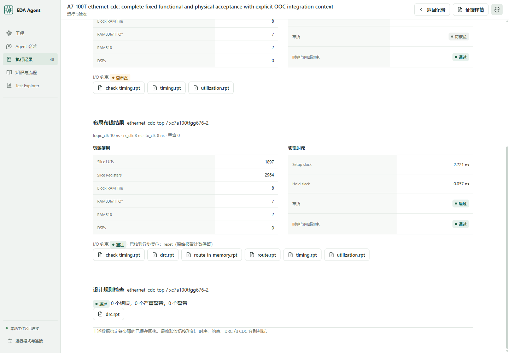

# A7-100T：8 项已有工程的完整复跑与验收

**8/8 已有工程重新执行工具流程后通过最终 OOC 验收。** 输入来自已有开源核和本地集成工程；本轮没有从空白规格自主生成 8 套 RTL。7/7 Pi 会话通过独立在线证据评测，301 项离线软件测试通过且无跳过。器件固定为 `xc7a100tfgg676-2`，单时钟工程 100 MHz，Ethernet logic 100 MHz、GMII 125 MHz。模型不得改 testbench、固件、向量、接口或时钟。

“完整复跑”指重新执行仿真、综合、布局布线和 DRC，并保存新回执。7 个 verifier 工作流的 `resume_from` 均为空；实现读取本次综合产生的 DCP。FFT 也使用新的工具运行目录。框架和集成故障由 Codex 修复，随后 Pi 执行最终固定验收；FFT 由 Codex 调用原生 EDA 工具。具体角色和失败历史见下文。

| 工程 | 最终功能检查覆盖量 | Setup / hold（ns） | LUT / FF | DRC |
|---|---|---:|---:|---:|
| RV32IM SoC | 8 场景、40 算法检查、8 中断检查、2,603,603 次总线事务 | +2.738 / +0.087 | 1,873 / 1,254 | 0 |
| AXI DMA | 717 场景、3,064,242 字节检查、10,568,464 次协议检查 | +1.414 / +0.089 | 910 / 584 | 0 |
| UDP/IP/ARP | 收发各 65 包、62,272 字节，以及校验和、截断、ARP 失败路径 | +2.422 / +0.035 | 1,598 / 2,924 | 0 |
| AES stream | 532 块加解密、20 密钥组、4 复位场景 | +0.560 / +0.083 | 3,199 / 2,903 | 0 |
| AXI 3×3 | 4 种子、4,656 个 burst、658,158 次协议检查 | +1.698 / +0.058 | 2,011 / 2,014 | 0 |
| RV32IM + AES DMA | 3 种子、42 描述符、26,592 密文字节、21 次错误恢复 | +0.552 / +0.062 | 5,111 / 4,854 | 0 |
| 三时钟 Ethernet | 2 个时钟比；各 281 次有效回显、201,023 线缆字节、6 类共 24 个负向输入 | +2.721 / +0.057 | 1,897 / 2,964 | 0 |
| 1024 点 FFT | 16 帧、16,384 个频点；4/4 数值与协议破坏被拒绝 | +1.692 / +0.041 | 2,704 / 4,472 | 0 |

资源取交付 DCP 的 `report_utilization`；所有工程黑盒为 0、可布线网络全部完成、路由错误为 0。FFT 使用 12 DSP 和 3 个 BRAM tile；复数分量最大误差 1.054 LSB，固定阈值 4 LSB。

7 项为原版 Pi 1.4 / 宿主 verifier 会话，最终共 29 次验证工具调用；FFT 为 Codex 调用原生 EDA 工具的完整流程。框架和集成问题由 Codex 修复，再让 Pi 会话执行固定最终验收；7 项候选 RTL 的哈希均与原件一致。本轮衡量工程接入与验收链路，不能解释为自主 RTL 修复率、盲测或从零生成 RTL 的成功率。

前一批 10 次会话尝试中 4 次交付通过，6 次未通过或中断，失败产物全部保留；此前未完成的验证额度没有重置。计入最终验收后，每个工程累计 2–3 轮、7–9 次验证调用，未超出原定 4 轮 / 24 次上限。最终轮的 7/7 不覆盖这些失败记录。

本轮修复了 CDC Tcl 被 XDC 解释器跳过、异步复位输入被混作漏约束、Vivado 当前内存中的常量伪网络状态影响交付判定，以及 AES 独立编译列表的 timescale 顺序问题。接入脚本被冻结到候选；复位按实际网表核验；路由报告从重新打开的交付 DCP 生成，原始报告保留；FFT 的动态依赖通过原生工具显式捕获。新增回归覆盖被跳过的约束、错误复位结构和脚本保护边界。

工作台可以从会话打开候选 RTL 与原件对照，再进入综合与实现，查看资源、setup/hold、I/O 约束、复位核验和原始报告。浏览器实测打开了最终 Ethernet 的 RTL、综合/实现页面和 `route.rpt`。

2026-10-27 界面调整：运行页使用紧凑验收表，综合估算与布线后数据并列，原生报告按阶段组织；候选源码默认单栏，支持原件对照、分页及固定依赖分组。会话回放去除重复交付文字，保留工具和 verifier 记录。此次调整未重跑 EDA，也未调用模型 API；上图保留原验收时的截图。

CommandCode 本次 8 工程批次共 **125 请求，已回报 7,485,083 tokens**；另有 **2,689,940 tokens 未回报用量的保守预留**。其中最终 7 项验收仅 14 请求、387,236 tokens。整个稳定性活动累计 248 请求及 1 次探针，已回报 11,342,150 tokens，未知用量预留 3,498,428，合计预算占用 14,840,578 / 50,000,000。预留不是实际账单；其他模型 API 调用为 0，外层 Codex 用量未纳入。使用 CommandCode 的 DeepSeek v4 Flash 请求标识，服务返回 v4.1 Flash 标识。

核对入口：[逐工程回执与历史](../release/summary-a7-eight.json)、[脱敏原始报告](../release/summary-a7-eight-evidence.json)、[7 项在线评测](../release/evaluation-a7-eight.json)、[301 项离线验收](../release/validation-a7-eight.json)。离线验收来自独立导出和安装后的 API 关闭环境，包含 273 Node、21 Python optimizer、7 ACE bridge 测试。原始 DCP、波形及完整会话仍保存在本机；公开报告和哈希不等同于第三方复现。

复跑与边界见 [A7 工程入口](../projects/a7-validation/README.md)。本轮固定 OOC 集成夹具使用 3.3 V 配置电压假设、外部 BUFG 位置和接口布线范围；具体板卡引脚、电压及硬件运行尚未验收。Ethernet 的独立结构诊断保留 34 条 CDC warning（CDC-6：3，CDC-15：28，CDC-26：3），未计为完整 CDC 签核；形式证明也未执行。
