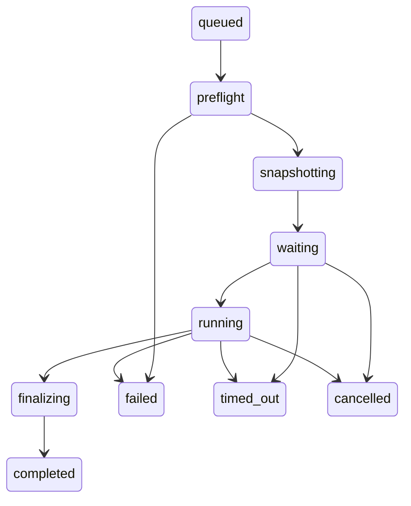

# Agent 实验基座

这套基座把现有 Pi Agent、真实 EDA 工具、测试目录、验收和证据放在同一条调用链中。当前模型 API 停用；Codex、CLI 或 MCP 可以直接运行本地实验。板卡实测、外部 formal 工具和盲测代码生成成绩仍须另行取得。

早期交付与实跑记录见 [2026-10-23 验收报告](history/agent-foundation-validation-2026-10-23.md)。当前能力和缺口见 [机制核对](mechanisms.md)，成绩按功能见 [结果目录](results.md)。

当前工具选择、优化器事件链、Pi 兼容和失败恢复以 [Agent 工作流与 trace 接入合同](agent-workflow-and-trace-contract.md)为准；历史验收数按原报告保留。


主要入口：

| 组件 | 代码 / 配置 | 用途 |
|---|---|---|
| CLI / SDK 会话 | `src/agent.mjs`, `eda.ps1` | 无模型本地命令，以及启用后可用的 Pi 会话 |
| 统一注册 | `src/extension.ts`, `.pi/extensions/eda.ts` | 4 个基础 EDA + 6 个 FPGA + 1 个优化器 + 5 个实验管理接口；TUI/SDK 共享 |
| MCP | `src/mcp-server.mjs`, `.pi/mcp.json` | 官方 TypeScript SDK 2.3.1 stdio；同一注册表和资源额度 |
| 调度 / 状态 / hooks | `src/runtime.mjs`, `.eda/config.json` | XSim 2、Vivado 1、LTspice 1、验收 4；跨进程 ticket 排队与文件租约 |
| 测试与比较 | `benchmarks/`, `src/bench/` | 分类、种子、独立 oracle、验收、baseline/candidate 比较 |
| 知识 / 技能 | `knowledge/`, `.pi/skills/`, `.agents/skills/` | 来源规则、本地技能及 [Ross 技能](history/ross-integration-2026-10-24.md)；加载时核对版本和前提 |
| 证据 / 存储 | `src/trace.mjs`, `scripts/trace-inspect.mjs` | 输入哈希、内容对象、事件、进程、关联 ID、完整性检查 |
| 迭代检查 | `scripts/validate-platform.mjs`, `.github/workflows/validate.yml` | 本机真实回执；离线 CI 配置 |

## 直接使用

```powershell
.\eda.ps1 doctor
.\eda.ps1 benchmark list
.\eda.ps1 benchmark plan --tier light --seed 1
.\eda.ps1 benchmark run --ids counter,rc-ac,gen-adder-w4 --seed 1 --concurrency 2
.\eda.ps1 benchmark report artifacts\benchmark-实际目录
.\eda.ps1 benchmark compare artifacts\baseline目录 artifacts\candidate目录
.\eda.ps1 knowledge clock
.\eda.ps1 trace artifacts\某次工具运行目录
node scripts/replay-experiment.mjs artifacts\某次工具运行目录\run.json --check-only
.\eda.ps1 runs
.\eda.ps1 storage --plan
npm test
node scripts/validate-platform.mjs --real
```

最后一条会运行离线测试，并通过真正的 MCP 客户端调用 XSim 计数器，再检查其 trace。每次生成新的验证回执。查看知识来源与许可证用 `node scripts/check-knowledge.mjs`；标准 MCP 客户端以 `node src/mcp-server.mjs` 启动服务。当前没有 HTTP 常驻服务、远端数据库或额外遥测上传。

## 状态与恢复



每个原生工具使用 `preflight → snapshot → resource_acquire → execute → finalize` hooks，记录开始、结束、耗时和错误。参数和文件检查先于资源排队。队列支持超时和取消，子进程记录 PID、命令、退出码、耗时及停止原因；只终止本次工具拥有的进程树。配置中的 hooks 列表描述内置顺序；增加可执行 hook 需修改代码并验收，配置不会执行任意 shell。

排队按 ticket 时间和 UUID 排序，持有资源期间保留 ticket，防止连续新请求抢在旧请求前面。同一毫秒的请求按 UUID 排序；系统时钟回拨会影响排序。取消和超时只移除自己的 ticket；明确死亡的 owner 会被跳过并保留证据，未知 owner 保守保留。Windows 的显式恢复使用有 30 秒界限的隐藏 PowerShell 原子目录移动，避免覆盖后来出现的 guard。

`.eda-state/runs/` 是便于查询的派生索引，原始 `artifacts/*/run.json`、`events.jsonl` 和日志是证据。进程意外退出后，先运行 `eda.ps1 runs`，再显式运行 `eda.ps1 runs --reconcile`。恢复只在父进程和记录的子进程均已消失时归档租约、修正索引；有活进程、缺失 PID 或无法读取证据时保留。不会自动重试工程。保留的未知租约需要人工核对。

工具 `completed` 表示调用结束；设计是否通过由固定验收给出。负例通过必须出现预定错误，普通错误或超时不会变成设计 PASS。完整性损坏、输入在运行中变化、验收缺失必须单独暴露。

## 实验迭代

1. 用 `plan` 固定目录版本、题目、种子、验收和并发条件，先运行小 smoke。
2. 保留 baseline 目录。在独立源文件或分支中修改设计 / Agent，记录改动动机和目标指标。
3. 用相同题目与验收运行 candidate。先检查失败原文、输入完整性和未解析依赖，再解释分数变化。
4. `compare` 列出可比项、候选输入变化、退步和不可比原因。测试或 oracle 变化须建立新基线，不能宣称旧成绩直接提升。
5. 将可复现问题加入合适分类；回归、代码审查及证据检查通过后再采用新实现。失败实验与未解决问题保留在各自回执。

来源任务数、参数变体数、随机向量数、PASS 数分别报告。已有工程回归不能代表模型盲测成功率；更换模型后的费用、token、工具轮次需要真实会话另测。当前本地 benchmark 的模型 API 调用数为 0，外层 Codex 用量单独统计。

## 体积与边界

默认不请求波形，参数化用例按种子即时生成。输入先写入按 SHA-256 寻址的对象，再用硬链接或复制保存兼容路径；不会链接到可变源文件。重放前验证对象和快照内容。历史产物保留；`storage --plan` 只给盘点和候选清单。详见 [trace 与存储](trace-storage.md)。

重放使用 `scripts/replay-experiment.mjs RUN_JSON --run`，会创建新实验。当前工作区输入改变、快照损坏或存在未解析依赖时拒绝执行；需要先在隔离副本中准备匹配输入。没有打包商业工具安装包、许可证或完整操作系统，因此不承诺跨机器位级一致。

知识在 AMD、lowRISC、OpenTitan、cocotb、Verilator、Yosys/SymbiYosys、FuseSoC/Edalize 等已有资料基础上建立适用条件，详见 [知识与成熟工具](fpga-knowledge-and-tools.md)。未安装的工具显示为未接通；Ross 新版本技能不能直接当作本机 Vivado 2020.2 能力。

MCP 使用 [官方 TypeScript SDK](https://ts.sdk.modelcontextprotocol.io/v2/get-started/first-server)，客户端按 [官方 stdio 连接方式](https://ts.sdk.modelcontextprotocol.io/v2/clients/connect)验证。现有 Analog Devices LTspice MCP 配置保留。CI 文件已配置，远端 CI 执行结果须等待实际仓库运行；本机测试结果以验证回执为准。
