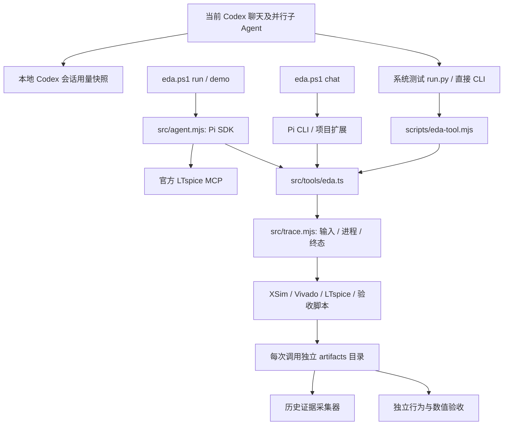

# Agent 框架与实验追踪

本项目已有两条执行路径，共用原生 EDA 工具。当前系统实验使用 Codex 直接驱动本机工具；Pi SDK 的模型会话入口保留，其他模型 API 按当前用户要求暂停。

当前使用以 [Agent 工作流与 trace 接入合同](agent-workflow-and-trace-contract.md)为入口。下文保留初期协作与历史实验说明；本地注册表现为 16 接口，新增优化器内层事件链与 Pi 字段兼容检查。



## 真实入口与职责

| 入口 | 作用 | 模型调用 |
|---|---|---|
| `scripts/eda-tool.mjs TOOL args.json` | 单次原生工具调用，返回带目录的 JSON | 无其他模型 API |
| `projects/system-bench/run.py PROJECT sim/impl` | 系统测试及初步验收，保存独立结果与 latest 指针 | 无其他模型 API |
| `src/agent.mjs verify` | counter、RC 仿真与数值验收 | 无其他模型 API |
| `src/agent.mjs run/demo` | Pi SDK 驱动工具，限制轮次与墙钟时间 | 会调用配置模型，目前暂停 |
| `start-pi.ps1` / `.pi/extensions/eda.ts` | 原版 Pi 交互入口，复用 EDA 工具 | 交互模型调用 |
| `scripts/collect-system-evidence.py` | 核验所有留存系统测试，关联旧失败与新成功 | 无其他模型 API |

`src/tools/eda.ts` 注册最初 4 个工具，`src/tools/fpga.mjs` 增加 6 个，`src/tools/optimizer.mjs` 增加优化器，`src/platform.mjs` 提供 5 个实验管理接口；都由 `src/extension.ts` 统一注册。优化器内部本机 MCP 客户端已关联 trace；直接社区工具和官方 LTspice MCP 的日志覆盖仍单独判断。

## 每次原生调用的记录

```text
artifacts/<UTC>-<tool>-<UUID>/
  run.json       参数、输入依赖、SHA-256、进程、超时、终态、漂移
  events.jsonl   UTC 时间、序号、run_id、启动/进程/退出事件
  inputs/        已捕获源文件、Tcl、向量、生成器和运行器字节快照
  process.log    完整合并 stdout/stderr，以及命令与追踪失败信息
  receipt.json   兼容旧调用者的目录、产物、状态和错误
  ...            工具自身日志、测量、报告、波形、checkpoint
```

- 每次调用在校验前建立记录；参数错误、编译错误、非零退出、超时和取消都保留回执。CLI 启动前发生的模块加载异常尚不能保证进入该记录路径。
- 进程记录包括可执行文件、参数、工作目录、PID、起止时间、退出码、信号和停止原因。只终止当前工具启动的进程树。
- 直接声明的输入及静态可识别的 Verilog include、readmem、Tcl source/read、SPICE include 会被捕获。无法解析的动态表达式列在 `unresolved_dependencies`，不会假装依赖齐全。
- 当前执行仍读取原工作区路径；快照保存开始捕获的字节，结束时再次计算源哈希。`input_drift=true` 表明运行期间发生变化，不能声称这次运行使用了完整冻结输入。前后哈希也无法检测中途修改后恢复的情况。
- 版本仅写入实际可见证据：Node/OS 来自运行时；Vivado 实现版本来自 `build-result.json`，其他工具版本可查原始启动日志。未探测到的版本写为空。

`completed` 表示工具流程结束。设计是否通过，由 PASS 标记、错误/超时检查、数值比较和实现报告共同决定。例如 XSim `$fatal` 可能伴随进程退出码 0，不能单凭退出码计分。

Pi SDK 会话另保存 `prompt.txt`、编排代码快照、`run.json`、带时间戳/序号/session ID 的 `events.jsonl`、`answer.md`、`usage.json`。初始化失败、模型错误、限制停止和关闭错误都有记录。新增会话记录逻辑用离线 SDK 替身验证；本轮没有调用真实模型 API 验证。

## 查询与复跑

收集历史记录不会执行 EDA，也不会修改旧结果：

```powershell
python scripts/collect-system-evidence.py
```

每次生成新的 `artifacts/system-evidence-*/evidence.json` 和 `summary.md`，保留全部可发现尝试，单独列出最新留存结果。没有终态只记为缺少终态，不能仅凭文件推断进程仍活着。采集哈希证明采集时内容；旧实验缺失的输入快照、命令或用量不会被补写成历史事实。

对最初四个工具的 trace 先核对，再显式启动新实验；此自动复跑器尚不支持新增 FPGA 工具和优化器：

```powershell
node scripts/replay-experiment.mjs artifacts/<run>/run.json --check-only
node scripts/replay-experiment.mjs artifacts/<run>/run.json --run
```

复跑器检查快照哈希、当前源哈希、原运行漂移、未解析依赖和工作区路径。检查通过后用保存参数调用原生工具，结果写入新目录，保留原 run ID 关联。它不会覆盖当前源文件。若源码已变化，需在单独工作区审阅恢复输入及绝对路径，再产生新实验；不要覆盖活动工作区来追求复跑。

此检查不能证明静态扫描穷尽了依赖，也不能自动重建 Vivado 许可、工具安装、LTspice 用户配置或板卡环境。迁移机器需要另核对这些环境条件；不承诺布局布线产物逐字节一致。

## 用量与证据范围

```powershell
python scripts/capture-codex-usage.py --thread <thread-id> --output artifacts/<campaign>/codex-usage.json
```

可重复指定 `--thread`，包括实际参与的子 Agent；`--since <UTC>` 仅在存在之前的累计计数时计算差值。只读取指定聊天的计数器，不导出聊天正文、账户额度或凭据。快照截止到最后已写入的事件，不代表仍在运行的聊天最终总量。

- 原生工具的 `other_model_api_calls=0` 只说明该工具调用没有调用其他模型 API。
- 外层 Codex 的 tokens 从本地会话单独记录。缓存输入属于输入 token，推理输出属于输出 token，不重复相加。
- Pi 的 `usage.json` 使用 SDK 会话统计；费用是目录价格估计，不是账单。缺失用量写未知。

快照排除 `.pi-state`、凭据文件和环境文件，不保存完整环境变量。EDA 原始日志与电路源文件仍属于本地工程数据；工具脚本自行输出的敏感内容没有通用自动脱敏保证。

系统工程使用固定版本的公开核心和本地集成测试，不能归类为全部从零生成 RTL 的盲测。100 MHz OOC 时序通过不能替代板级 IO、bitstream 或上板验证。
