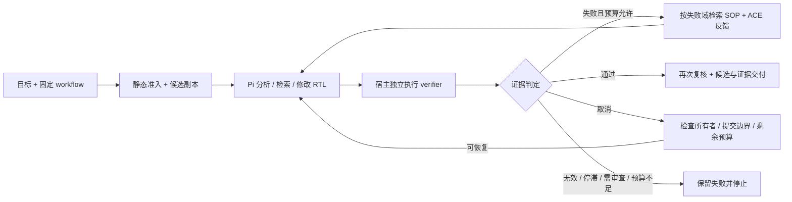

# EDA Agent 任务闭环

原生 Pi 负责分析、工具检索和 RTL 修复；宿主固定候选范围、检查证据、控制重试和交付。当前支持已有独立 checker 的 RTL 仿真，以及绑定功能检查的 FPGA OOC workflow。任意聊天没有绑定工程任务时，验收保持 `unknown`。



## 从入口到交付

| 环节 | 实现 | 宿主约束 |
|---|---|---|
| 准备任务 | [agent-task](../src/agent-task.mjs) 的 `prepareAgentTask`；原生 `eda_task_prepare` | 使用现有 workflow 的 checks/profile；识别固定 testbench top；保存合同和哈希 |
| 候选隔离 | 同模块复制声明的源文件、约束和 include 文件树，重写工具路径 | 保留相对目录；检查原始输入、候选保护文件、代码与知识的漂移；不覆盖原始 RTL |
| 生成与工具调用 | [agent-session](../src/agent-session.mjs)、[extension](../src/extension.ts) | Pi 继续使用 read/edit/write、codemode 和检索；写入只允许候选 RTL；shell、任意 MCP 与模型发起的 EDA 调用被阻止，防止绕过 verifier 预算 |
| 验证与修复 | [verifier-loop](../src/verifier-loop.mjs) | 每轮独立 workflow；宿主回读证据；原版 ACE 组件只提供修复建议；同候选同失败停止 |
| 按证据选知识 | [task-context](../src/task-context.mjs) | 首轮 planning，后续由实际失败域选择规则与 SOP；每轮记录选择和来源哈希；检索命中不代表 SOP 已遵循 |
| 压缩后恢复上下文 | [eda-coordinator](../src/eda-coordinator.mjs) 的 Pi `context` hook | 每次请求重建固定合同、可编辑文件、阶段、已用与预留预算；过往成功摘要不能接受新候选；保留 Pi 默认压缩 |
| 跨会话续跑 | `claimAgentTask` + `run --task ... --resume-task` | 检查所有者、代码/输入、最新证据与候选；新 attempt 目录；累计轮数与验证调用不重置 |
| 交付 | `taskDelivery`、`delivery.json`、`answer.md` | 关闭会话后再次核验，最终回答以宿主验收为准；原模型文字保存在 `model-answer.md`，供追踪 |
| 界面与测评 | [workbench](../src/workbench.mjs)、[evaluations](../src/evaluations.mjs) | 会话绑定候选，显示阶段、验证轮次、领域状态和证据；离线机制、真实 EDA、已有 Agent 会话分别计分 |

这保留了 AI 的分析与修复自主性。接受标准、执行额度和当前成功状态由可执行合同决定，不由模型文字或角色反馈决定。

## 使用

静态准备可在模型关闭时执行：

```powershell
node src/agent.mjs task prepare examples/verification/counter.json
# 用上条输出的 directory 替换下面路径
node src/agent.mjs task inspect artifacts/agent-task-UUID
npm run evaluate -- run offline-agent-loop
```

需要独立依赖的复杂工程可使用 [AXI 配置](../examples/verification/axi-fabric.json)。先按 [工程索引](../projects/README.md) 准备固定依赖。静态准入通过只说明任务合同可用。

以下命令会调用已配置模型及 workflow 中的 EDA；仓库默认关闭模型 API，执行前须按当前授权配置本机提供商：

```powershell
node src/agent.mjs run --task artifacts/agent-task-UUID --timeout 3600 "修复候选 RTL，满足固定验收"
node src/agent.mjs run --task artifacts/agent-task-UUID --resume-task --timeout 3600 "从已验证边界继续修复"
# 也可直接从配置创建新候选并进入同一闭环
node src/agent.mjs run --verification examples/verification/counter.json "完成固定任务"
```

工作台：新建会话 → **验证任务** → 选择 workflow、RTL 和预算 → **创建候选并固定范围** → **范围与证据**。准备与检查可离线使用；模型门关闭时启动按钮禁用。解除会话绑定保留任务与证据。

原生工具与 CLI/MCP 共用注册表。`eda_task_prepare` 返回宿主可运行的任务目录；它本身不启动 Agent。Pi 的普通交互入口仍可进行探索；需要宿主自动修复循环时使用上述 `run` 或工作台验证任务入口。

## 状态和恢复边界

`prepared → generating → verifying → boundary` 是任务执行过程。独立结论可能为 `passed`、`failed`、`unknown`、`review_required`；循环也可能以 `cancelled`、`invalid` 或 `budget_exhausted` 结束。会话 `completed` 只说明驱动结束。

只有取消后的工具终态与证据已收齐，并提交到 **boundary**，最新候选、合同和所有者检查通过且额度足够时，才允许续跑。运行中的仿真被正常取消后可以形成此边界，验收仍是 `unknown`；续跑会重新执行固定验证。生成中断、未收齐证据的验证中断、未提交 attempt、存活/未知所有者、证据变化或预算不足均拒绝自动续跑。硬崩溃若没有完整提交边界，也不能凭耗时推测可恢复；保留现场并重新准备任务。

验证 `max_rounds/max_calls` 跨续跑累计。模型 `maxTurns/timeoutSeconds/maxToolCalls` 按每次宿主会话计量；普通工具、被拒绝请求与 codemode 嵌套调用共用 `maxToolCalls`（默认 128，可用 `--max-tool-calls` 设置）。额度耗尽或取消后，宿主在 Pi 的下一次请求边界阻止继续派发。当前任务上下文在压缩后重新附带剩余工具额度、轮数和时间。Pi 原生压缩逻辑保留；这些上限不是精确的 HTTP 请求数或 token 预算。

原生 SDK 的 codemode 使用 `models:false`，关闭脚本内额外分类/图像模型入口；脚本仍可组合已准入工具。该限制属于原生 `run` / 工作台会话驱动；直接启动上游 Pi TUI 的探索会话不具备相同宿主预算。

usage 保留 Pi 会话累计量、本次增量、工具准入计数与 `execution_provenance`。使用注入 session factory 的测试自动标记 `injected`，不能因 provider 名称看起来真实而计入线上成绩。未取得统计记未知。ACE 桥接的 0 API 调用不表示外层 Codex token 为 0。

## 证据布局

```text
artifacts/agent-task-UUID/
  task-contract.json       固定原输入、候选映射、验收与知识
  task.json                合同哈希、attempt 目录与已提交回执哈希
  candidate/               声明的设计输入副本
  workflow.json            指向候选的固定规格
  owner.json               仅运行期间存在的独占所有者
artifacts/native-agent-*/
  verification-contract.json
  verification-loop.json   阶段、累计预算、逐轮判定与 SOP 选择
  delivery.json            最终重新检查的工程交付
  answer.md                宿主结论
  model-answer.md          原模型文字
  events.jsonl / usage.json
```

失败产物和历史成绩保留。候选可交付给用户审阅；系统不会自动合并到原始设计。取消订阅异常会记录失败终态并继续关闭任务；异步 dispose 完成后才复核当前输入与候选。进程硬崩溃或磁盘无法写入仍按未提交 attempt 处理。

## 已验证与尚未验收

`offline-agent-loop` 按 isolation、guidance、context、dispatch、integrity、ownership、recovery、budget、delivery 分类运行模拟场景。它使用真实任务/workflow/trace 代码和假 EDA，不衡量 RTL 能力。完整软件检查、真实原版 ACE 反馈演示见 `npm run validate:agent`；最新公开回执见 [release](../release/README.md)。

[真实 SDK 调度检查](../tests/pi-sdk-dispatch.test.mjs) 用 Pi 1.4.0 和 QuickJS 执行嵌套工具，通过内存中的固定响应验证正常结束、工具超限、轮次超限、checker 保护、worker 排队/取消、原生压缩和重试终态。测试不创建提供商客户端、不读取真实凭据、不启动 EDA；它验证 SDK 兼容性，不计入真实模型成绩。

候选快照仅覆盖声明的文件；IP 生成模型、自定义仿真库、数据文件的运行期定位仍需 workflow 明确编排。工具 hook 和哈希检查不是 OS 沙箱；不能对恶意插件、外部进程或对抗性 HDL 宣称强隔离。当前只提供固定测试的工程证据，不是形式等价、CDC 签核或板卡实测。

授权后的原生 Pi/CommandCode 修复、压缩、取消、恢复与 MCP 实测见 [稳定性记录](stability-2026-10-26.md)。独立盲测、答案引用忠实度和自然语言 SOP 遵循率仍需单独评估。向量检索、远端商业 EDA 和多用户权限未接入本闭环。历史真实工程结果保持各自原协议，见 [功能成绩](results.md) 与 [分类测评](evaluation.md)。
