# Agent 工作流与 trace 接入

当前入口是 Codex → 55 个原生接口 / 45 个社区 Vivado MCP 接口；Pi 会话可复用原生注册表，但模型 API 当前禁用。工具执行、设计验收和优化收益分别判断。本文是 Agent 的导航与证据合同；历史成绩仍以各次原始报告为准。

统一代理、恢复和 OTLP 的操作入口见 [Agent 闭环交付](agent-completion-2026-10-24.md)。

多工具任务使用 [持久化 workflow](workflows.md)：冻结规格、逐步验收、预算、子 trace 和恢复。成熟仓库对照及剩余差距见 [源码比较](history/repository-comparison-2026-10-25.md)。

## 按任务选择入口

| 阶段 | Agent 要取得的证据 | 入口 |
|---|---|---|
| 明确任务 | 顶层、器件、频率、接口、复位/时钟域、资源目标、固定验收条件 | 项目规格、RTL/XDC、testbench；缺关键输入时再询问 |
| 前检 | 本机路径、版本限制、活动任务、资源额度 | `eda_preflight`、`eda_runs`；路径存在不能证明许可证或板卡可用 |
| 编排 | 固定输入、步骤依赖、验收、预算、已提交状态 | `eda_workflow_plan` 不启动 EDA；`run/resume` 按规格执行，失败即停；恢复前用 `resume_check` |
| 理解设计 | 层次、时钟、关键路径、CDC/DRC、已有失败 | `eda_task_context`、`eda_knowledge`、`eda_sop`、6 个 [FPGA 工具](fpga-native-tools-2026-10-24.md)、已有报告 |
| 工程装配 | 工程/IP/BD 的实际配置及导出 Tcl | [Workbench](../projects/native-vivado-workbench/README.md)；查看 `ok`，失败可能留下部分修改 |
| 功能/实现 | 固定 checker、负控、综合、布局布线和约束完整性 | `eda_xsim`、Vivado 工具、[benchmark](benchmark-catalog.md)；功能和时序独立验收 |
| 优化 | 基线、候选依据、预算、拒绝理由、收益、独立复测 | `eda_vivado_optimize`；`plan` **也会启动 Vivado 测基线**，纯静态任务不要调用它 |
| 交付 | 证据有效性、运行终态、设计验收、剩余问题和用量 | `eda_trace` / `trace-inspect`；链接报告、DCP、trace；报告实际 gain |

当前静态查看使用 `eda_trace`、`eda_runs action=list` 或读取源文件；`.\eda.ps1 verify`、benchmark `run`、`validate-platform --real` 都会启动真实 EDA。

## 哪些 trace 已经接通

| 路径 | 已有记录 | 当前连接与检查边界 |
|---|---|---|
| 原生 CLI / `eda-local` MCP | `run.json`、`events.jsonl`、输入快照、进程、回执 | `eda_trace` 核验；同一注册表的工具共用 trace；跨次任务关联需要显式 context/白名单环境变量 |
| 知识 / SOP → workflow | 查询、排名、来源与语料哈希；计划中的 guidance 选择与输入哈希 | [知识合同](knowledge-and-sops.md)；SOP 改动阻止旧任务续跑，选择流程不等于全部规则已执行 |
| 持久化 workflow → 原生子工具 | 任务 checkpoint、子 trace/span、逐步验收、产物哈希 | `eda_workflow_inspect/resume_check` 检查完成前缀；恢复创建新运行，保留原证据；模型会话恢复另属 Pi SDK |
| Pi SDK → 原生工具 | 会话 trace/span、工具父 span、usage | 工具继承会话 ID；检查器兼容 `runId/sequence/agent_run_id`；新会话初始化失败也落终态。Pi CLI/TUI 不等同于此 SDK 会话 trace |
| 原生优化器 → Python → 本机 MCP | `optimizer-events.jsonl`、结果、候选、MCP 日志 | **本次接通**：继承原生工具 trace；候选/复测 span 包含客户端 MCP 调用 span。真实服务端未增加分布式传播协议 |
| 社区全部 45 个工具 | 代理统一 `run/events/receipt`、响应哈希；13 个 `wb_*` 另保留 Tcl/回执 | Codex/Pi 已配置本地代理并共享资源锁，重连生效。检查全部工具的 MCP 边界；动态 Tcl 依赖仍不完整 |
| Benchmark / 系统实验 | campaign/case、汇总、checker、所引用的子运行目录 | 用 benchmark report/compare 或系统证据采集器；独立旧脚本不保证统一 span |
| 官方 LTspice MCP / Ross | LTspice Pi 配置已使用通用代理；Ross skills | 公共代理用假后端验证，真实 LTspice bridge 本轮未重测；Ross MCP 二进制仍未连接 |
| OpenTelemetry / Langfuse 等平台 | 本地 OTLP JSON 导出及显式 HTTP JSON 发送器 | 已验证本机接收、失败状态与部分拒收；默认不上传。外部平台仍需 endpoint/鉴权/编码验收 |

旧优化器成功记录只有结果和日志，检查时提示 `legacy_result_only`。旧事件不补造时间戳或 span。目录存在、工具数量、`completed`、零 API 调用均不构成设计通过证据。

```mermaid
flowchart TD
  A[可选 Pi SDK 会话 span] --> T[原生工具 span / trace_id]
  T --> P[Python 进程 span]
  T --> O[优化器 span / 同一 trace_id]
  O --> B[基线测量 span]
  O --> D[策略和预算事件]
  O --> C[候选 span / candidate_id]
  O --> R[最终复测 span]
  B --> M[MCP 客户端调用 span]
  C --> M
  R --> M
  O --> E[最佳结果更新 / 停止 / 终态事件]
```



优化器是工具 span 的子级，与 Python 进程 span 同级；通过 `optimizer_link` 和进程参数关联。不会把并非父子关系的记录伪装成父子 span。

## 优化器事件与结果合同

代码路径：[工具](../src/tools/optimizer.mjs) → [CLI](../scripts/optimize-vivado.py) → [循环](../src/fpga_optimizer/runner.py) → [MCP 后端](../src/fpga_optimizer/backend.py)。[事件写入器](../src/fpga_optimizer/trace.py) 与 [离线检查器](../src/optimizer-inspection.mjs) 不导入模型 SDK。

每个事件包含 `schema_version=1`、递增 `seq`、UTC、`run_id`、`trace_id`、`span_id/parent_span_id`。`optimizer-result.json.trace` 记录外层父 run/span 和事件文件。只追加事件并逐次刷盘；结果和 `best.json` 原子更新。多文件之间没有事务，中断窗口会被检查器标为不完整。

| 事件 | 可回答的问题 |
|---|---|
| `optimizer_start/end`、`span_start/end` | 从哪里进入，在哪个阶段结束、失败或取消 |
| `baseline_admission`、`plan_selected` | 基线能否进入优化，为什么采用该动作顺序，缺哪些特征 |
| `budget_decision` | 还剩多久，预计多久，估计来自历史耗时还是本地启发式，是否允许继续 |
| `candidate_admission/end` | 候选 ID、验收失败原因、WNS/TNS、比较门槛、接受/拒绝/失败状态 |
| `best_updated` | 最佳 DCP 的更新或回退顺序、路径、哈希和时序指标 |
| `winner_validation`、`search_stopped` | 最终复测是否通过，为什么停止 |
| MCP `span_start/end`、`session_cleanup` | 调用名称、参数哈希、超时、耗时、异常类型和清理是否成功 |
| `evidence` | 候选输入、测量、计划、生成 Tcl、MCP 日志、选中 DCP 的相对路径、大小和 SHA-256 |
| `recovery_checkpoint` / `recovery_from` | 已提交边界、不可变 journal 哈希、恢复源 trace/span；新目录复测后继续 |

完整 Tcl/响应仍保存在本地文件，摘要不回传正文。事件记录可观察的选择依据，不保存或推断模型内部思维。哈希只能检验已留存证据的一致性，不能证明数据真实性、全部动态依赖、形式等价或硬件表现。

`status` 表示运行生命周期；`outcome` 表示优化结论：

| outcome | Agent 后续动作 |
|---|---|
| `planned` | 阅读计划；尚未尝试候选 |
| `improved` | 核对实际收益、最终复测和独立功能验收 |
| `no_gain` | 保留基线；根据报告调整策略 |
| `candidate_errors` / `candidate_rejected` | 查看失败调用或验收原因，保留验收门槛 |
| `budget_exhausted` | 查看预算估计；本次没有启动候选 |
| `revalidated` | 恢复段完成复测且无额外候选；查看累计历史与最终结果 |
| `unverified_winner` | 已回退基线；复测证据不足，先诊断 |
| `blocked_by_baseline` / `failed` / `cancelled` | 修复证据或执行前提；确认任务状态后新建运行 |

`accepted_attempts` 统计曾被接受的候选；最终收益以复测后的 `best` 和 `wns_gain_ns` 为准。曾提升后回退时，接受数可大于 0、最终收益仍为 0。

```powershell
# 以下均离线；替换为实际运行目录
node scripts/trace-inspect.mjs artifacts/<run> --format md
node scripts/trace-inspect.mjs artifacts/<run>/optimizer
.\eda.ps1 runs
```

`eda_trace` 参数为 `{"directory":"artifacts/<run>"}`，也接受内部 `optimizer` 目录；`action=recovery-check/export` 分别检查恢复条件或本地导出。`valid` 检查结构、哈希、父子关系和终态一致性；运行中即使结构有效也没有 `reviewable_checkpoint`。终态缺失时，先看 `eda_runs` 的所有者与子进程，时间久不等于进程死亡。`eda_runs reconcile` 只核对并回收无主租约，不杀进程、不恢复 Vivado 状态。

自动复跑器 `replay-experiment.mjs` 仅支持最初四个工具。优化器使用独立 `recover-optimizer.mjs` 或 `resume_from`：验证 journal、代码/DCP 和所有者，复制已提交状态到新运行，重新测量后继续；不恢复旧进程内存。启动中的 MCP 服务需重连才能加载新代码。

本次改动验收与限制见 [静态审计报告](history/agent-static-audit-2026-10-24.md)；存储和关联变量见 [trace 与存储](trace-storage.md)；实测优化基线见 [优化器历史报告](native-optimizer-2026-10-24.md)。
