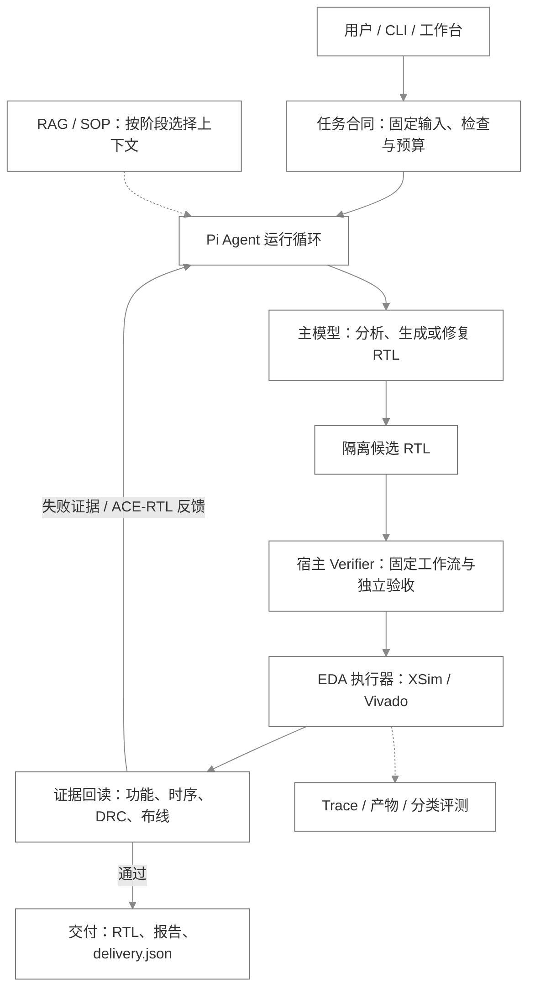

# 当前框架总览

当前框架以 **原生 Pi 1.4 会话负责生成与修复，以宿主 verifier 负责工程验收**。工作台、CLI 和 MCP 共用工具合同、执行调度与证据体系。下图按 2026-10-28 本地源码整理，描述逻辑模块；各节点不代表独立服务或数据库。

## 一次任务怎样闭环

1. **固定任务**：准备规格、器件、时钟、输入、测试和验收条件，复制隔离候选，声明允许修改的 RTL 与累计预算。
2. **生成候选**：Pi 在同一会话中分析、检索和修改。宿主按当前阶段提供规则、SOP 和任务状态；绑定验证任务使用限定工具集合。
3. **独立验证**：宿主执行固定 workflow，调用 XSim / Vivado，并回读报告、输入哈希和逐步检查结果。
4. **反馈修复**：失败信息经过 ACE-RTL 反馈组件；依据功能、时序、CDC 或恢复问题选择下一轮知识，继续修复。预算、输入漂移与重复失败可以停止循环。
5. **交付证据**：宿主重新核验并写入 `delivery.json`，工作台显示 RTL、报告与分领域结论；模型原始回答单独保留。

## 模块与源码

| 模块 | 当前职责 | 源码入口 |
|---|---|---|
| 交互与工作台 | 持久化会话、工程资产、RTL 阅读与限定范围修改、运行详情、分类评测 | [workbench](../src/workbench.mjs)、[工程资产](../src/workbench-projects.mjs) |
| Pi 会话 | 原生 SDK、工具选择、事件、重试与压缩；绑定任务时向模型开放 12 个工具，宿主保留完整注册表 | [agent-session](../src/agent-session.mjs)、[extension](../src/extension.ts) |
| 任务合同 | 隔离候选、固定输入、修改范围、所有者、累计预算、取消后的恢复条件 | [agent-task](../src/agent-task.mjs) |
| RAG 与 SOP | 本地 BM25；36 条规则、21 个来源、6 个 SOP；保留版本、适用范围与哈希，按失败域选择上下文 | [knowledge](../src/knowledge.mjs)、[task-context](../src/task-context.mjs) |
| Verifier 闭环 | 固定 workflow、独立验收、ACE-RTL 反馈、修复复验；压缩后恢复最新任务事实 | [verifier-loop](../src/verifier-loop.mjs)、[workflow](../src/workflow.mjs)、[eda-coordinator](../src/eda-coordinator.mjs) |
| EDA 执行 | 原生工具与社区 MCP 代理；资源租约、队列、超时和取消；Vivado / XSim 为主要 FPGA 后端，LTspice 为模拟电路扩展 | [runtime](../src/runtime.mjs)、[MCP 代理](../src/traced-mcp-proxy.mjs) |
| 验收与证据 | 功能、时序、CDC、DRC、布线等分别判断；记录输入、调用、失败、产物与最终交付 | [task-outcome](../src/task-outcome.mjs)、[trace](../src/trace.mjs) |
| 分类评测 | 离线软件/检索/证据检查、真实 EDA 运行、真实 Agent 会话证据复核分别计分 | [evaluations](../src/evaluations.mjs)、[评测协议](evaluation.md) |

物理优化器是独立执行分支，具有候选准入、最佳结果保留和最终复测；当前适配 7 个策略。其时序收益与 RTL 生成任务分别计分，见[机制说明](mechanisms.md)。

## 已有证据与边界

2026-10-27 的记录包含 **310 项离线软件检查通过**；DMA 和 4×4 包交换机经过诊断辅助及原生 Pi 续修，最终固定工程验收、原生交付、在线会话证据复核均为 **2/2**。首次 verifier 为 **0/2**。这是可见测试下的修复结果，不能作为独立盲测或首次成功率；[完整成绩与失败记录](rtl-repair-2026-10-27.md)。

框架已经具备生成、验证、修复和交付的连接机制。验收能力取决于固定测试与领域检查的充分性：`completed` 不等于工程通过，缺失证据保留 `unknown`，DRC warning 保留 `review_required`。上述两个项目为 A7-100T、100 MHz 的 OOC 验证，未完成板级实测或形式证明。

当前知识库没有向量索引或模型重排；自然语言 SOP 遵循率、答案引用忠实度尚未独立评分。修改范围属于工具策略约束，没有操作系统级强沙箱。工作台面向本机单用户；Synopsys 在独立项目中，商业执行需要授权。社区、Ross 和 LTspice 的安装与连接状态需按本机检查，图中出现后端不表示当前会话全部连通。

本次整理只核对源码、既有回执和架构图显示，没有新增模型 API 调用或 EDA 实跑。图直接使用 Mermaid，在 README 与本文中渲染。更多细节：[任务生命周期](agent-lifecycle.md) · [RAG 与 SOP](knowledge-and-sops.md) · [工作流与 trace 合同](agent-workflow-and-trace-contract.md) · [协作与 trace 文档](agent-framework-and-traces.md)。
