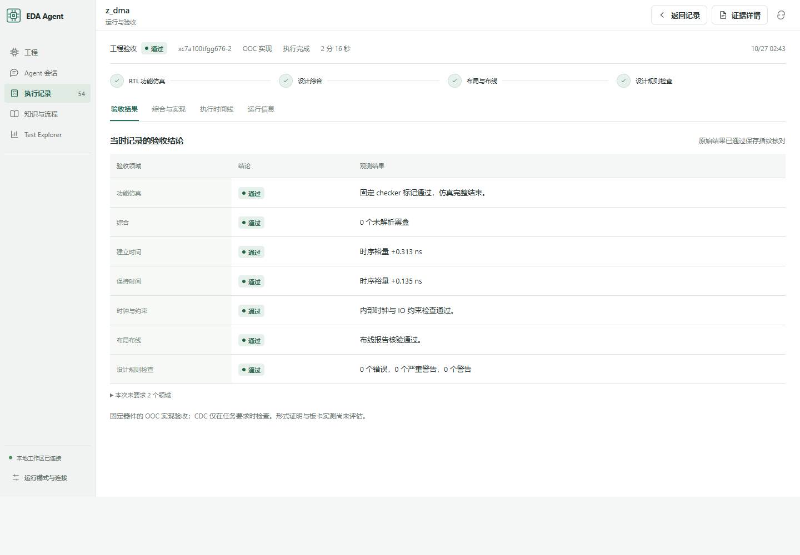

# 两项从零 RTL：固定 verifier 实测

**工程验收 1/2；Pi 自主闭环 0/2。** 两个原生 Pi 1.4 会话并行从端口空壳生成 RTL，通过 CommandCode 调用 `deepseek/deepseek-v4-flash`。DMA 最终通过；交换机在队列排空阶段失败。DMA 最后一次验收由 Codex 在模型会话失败后触发，因此不计为 Pi 自主完成。

| 项目 | 起点 → 最终候选 | 功能验收 | A7-100T 100 MHz OOC |
|---|---|---|---|
| 带描述符队列的 AXI4 DMA | 40 行接口 → 325 行 RTL | 128 描述符、84,491 字节、130,590 次协议检查通过 | Setup +0.313 ns；hold +0.135 ns；331 LUT / 214 FF；DRC 0 |
| 4×4 包交换机 | 20 行接口 → 307 行 RTL | phase 1 在 cycle 40,014 触发排空 watchdog | 功能失败后停止，未进入综合与实现 |

两项都是模块级新设计。此前 [8 项已有工程复跑](a7-eight-projects.md) 的成绩保持独立。空壳、固定 checker、候选与复跑入口见 [工程目录](../projects/rtl-from-zero/README.md)；机器可读成绩和哈希见 [公开摘要](../release/summary-from-zero-rtl.json)。

## 固定条件与实际覆盖

Codex 子 Agent 编写两个规格和独立 testbench，另一名审查者检查 checker。接口、测试、XDC、器件 `xc7a100tfgg676-2` 和 10 ns 时钟在模型运行前冻结。原始空壳均可编译、展开，并被功能负控拒绝。模型仅能修改候选 RTL；Codex 没有代写或修复这两份功能 RTL。已观测工具调用中未发现读取已有 system-bench/vendor RTL；读取限制属于策略约束，尚无操作系统级读沙箱。

DMA 为 64 位数据、单 outstanding 的 AXI4 INCR master，支持排队描述符、1–4096 字节传输、源/目的 4 KiB 边界、尾字节写掩码、读写错误、背压和复位。最终测试实际覆盖 24 个读错误、16 个写错误、2 次队列复位中止、81 个跨边界描述符，队列观测高水位为 9。84,491 是实际检查字节数；错误中止的请求不计成已复制字节。布线网络 655/655，黑盒、DRC 错误/严重警告/警告均为 0。

交换机固定要求每入口 16 beat 缓冲、按包轮询、出口受阻时保持输出、跨目的地维持入口顺序，以及四出口并行吞吐、计数器和复位。checker 计划覆盖 1,860 个完整包，包含三随机种子、公平性和满速窗口；本次停在早期排空阶段，**未取得这项计划覆盖量**。静态审查另发现跨出口包顺序可能被破坏，尚未单独动态复现。

## 失败与修复记录

| 阶段 | DMA | 交换机 |
|---|---|---|
| 最初生成 | 8,192 输出上限截断，未落盘；提高上限后重新生成 | 生成候选，首次功能验收失败 |
| 首批验收 | 首轮声明顺序编译错误；修复后功能通过，setup −0.599 ns | 排空 watchdog，随后分析被宿主故障中断 |
| 宿主中断 | Windows `EPERM` 替换 trace 文件异常逸出，第三轮中断 | 同一宿主退出，会话同时中断 |
| 修复宿主后 | 临时 Vivado 安装文件读取失败；再次执行后功能通过、setup −0.529 ns | 原候选复验仍失败；修复回复达到 32,768 输出上限，修改未落盘 |
| 最终状态 | Pi 最后修改落盘后会话失败；Codex 对该文件执行原固定 verifier，全部通过 | 候选仍为失败版本；未继续花费模型预算 |

宿主修复涉及 [trace 持久化](../src/trace.mjs) 和 [故障回归](../tests/trace.test.mjs)：独占临时文件、fsync、对 Windows 短暂锁占用做有界重试，并将进程回调中的持久化异常传给调用者。保留修复前副本和全部失败产物，**305 项离线测试通过**，其中新增 4 项持久化故障检查。[离线回执](../release/validation-from-zero-rtl.json) 不消耗模型 API、不启动 Vivado。

每项原定 6 轮 / 24 次 verifier 调用。中断后新建任务复制原候选，并扣除已用轮次和中断预留。DMA 最终共扣 6 轮、17 次调用额度（13 次完成调用 + 4 次中断预留）；交换机扣 4 轮、2 次调用，轮次包含中断/失败生成。DMA 最终 host-only 验收使用最后一轮额度。

两条最终 Pi 会话均为失败终态，独立 online-agent 评测拒收其不完整交付：[DMA](../release/evaluation-from-zero-dma.json)、[交换机](../release/evaluation-from-zero-packet-switch.json)。DMA 的额外 verifier 没有改写 Pi 的失败记录。最终工作流 trace 核验通过，73 项输入快照完整、无输入漂移。

## 用量、交付与边界

本批 **53 次 CommandCode 请求，4,028,246 已知 token**；宿主中断的一次请求用量未知，另保守保留 **885,626 token**。合计占用 4,913,872 / 6,000,000 本批额度，纳入用户 50,000,000 总预算。其他提供商 API 调用为 0；外层 Codex 和子 Agent token 不在上述 API 账单内。

32,768 输出 token 仍可能被提供商推理内容耗尽；本机 `thinking: off` 设置未在实际请求中显式控制该提供商的推理参数。最终 SDK 记录通用 `Connection error.`，没有新增 HTTP 账单条目；本批预算准入也是可能原因，现有回执不足以归因为提供商网络故障。这是后续需要修好的诊断与输出预算边界。

这些是可见本地测试，不是盲测 pass@1 或标准外部 benchmark。首次完整 verifier 为 0/2。DMA 有限刺激通过不等于形式证明；交换机缺乏已通过的参考 DUT 来动态验证整个 checker 的可满足性。两项均为单时钟 OOC，没有板卡引脚集成、CDC 签核或实板验证。

本机详细证据在 `artifacts/rtl-from-zero-20261027/final-result.json`。DMA 最终 workflow 为 `2026-10-26T18-43-31-953Z-eda_workflow_run-a02d53a6`；原始日志、DCP、私有模型会话和请求保留在本机。公开仓库提供源文件、固定测试、摘要和原件哈希。
