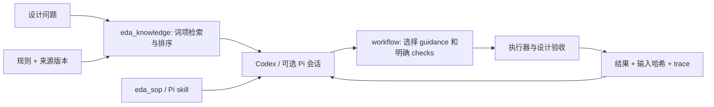

# 知识检索、SOP 与执行约束

当前知识层包含 **36 条规则、21 个来源、6 个本地 SOP**。它通过工具向 Agent 提供相关资料：`eda_knowledge` 返回规则、来源、适用版本和所需证据；`eda_sop` 返回操作步骤与规则引用。Pi 也会通过资源加载器发现同一份 SOP。入口共用本地文件，查询有 trace，不调用 embedding、重排模型或其他模型 API。

## RAG 到底接到了哪里

宿主 [验证任务](agent-lifecycle.md)在每轮生成前调用 `taskContext`：第一轮使用 planning，失败后根据当前 workflow 的验收域选择 simulation、timing 或 recovery 等阶段。选择记录及 SOP 哈希写入 `verification-loop.json`；Pi context hook 在压缩后保留当前任务范围、预算与选择。普通探索会话仍通过工具按需检索。自动选择没有替代固定 checks，也不表示模型遵循了 SOP 的全部自然语言条目。



`eda_task_context` 根据问题和 planning / simulation / timing / recovery / cdc / ip 阶段，整合前五条规则、最多两个 SOP 及其所需的实际工具合同。它可带 workflow 目录，重新核验工程状态与恢复建议。返回 schema bytes 便于观察上下文体积，不估算 token；不会自动改变 Pi 当前轮的工具集合。

绑定任务时先核验再检索：失效证据或重复失败转 recovery，功能失败转 simulation，物理时序与约束问题转 timing，CDC 问题转 cdc。显式指定阶段仍保留，并记录与证据推断的冲突。Pi 的 context 钩子按当前分支目录指针重建有界状态，压缩后的历史摘要不能覆盖最新 verifier 结果。修复循环与上游来源见 [ACE-RTL 接入](ace-rtl-adaptation.md)。

接入点是 Agent 的工具调用。模型可以按当前问题检索，再依据返回证据决定操作；框架没有对每个 prompt 自动检索，也没有自动审查最终回答的所有引用。模型 API 当前停用，本轮验证覆盖检索、资源加载、工具协议和任务状态，尚未验证真实模型生成答案的引用忠实度。

| 环节 | 当前实现 | 边界 |
|---|---|---|
| 知识整理 | 人工提炼为 rule / recommendation / limitation；保留 scope、versions、source_refs、evidence_required、static_proof_boundary | 原手册未全文复制；不是自动 PDF 抽取管线 |
| 索引与排序 | NFKC 归一化、英文词项、中文相邻双字；BM25，标题/标签重复加权；支持 ID、分类与来源过滤 | 仅搜索规则内容；没有 embedding、向量库或模型 reranker；分数不等于置信度 |
| 来源核验 | JSON 结构、来源 ID/URL/版本交叉校验；返回原始版本和来源检查日期 | 不在线复核链接或重新证明手册内容；来源的旧检查日期保持原样 |
| SOP 发现 | `knowledge/sops.json` 索引，`.pi/skills/*/SKILL.md` 为步骤正文；原生 `eda_sop` 与 Pi 共用 | 可选 Ross 技能只在本机存在时加载；公开包不提供 Ross MCP 二进制 |
| 阶段上下文 | [task-context](../src/task-context.mjs) 返回匹配规则、SOP 正文/哈希、所需工具 schema 与新鲜状态 | 选择理由可观察；未做独立 SOP 选择质量盲测 |
| 执行关联 | workflow 的 `guidance.rule_ids/sop_ids` 固定所选知识、来源和技能文件哈希 | 选择 SOP 不是合规证明；steps checks 与已绑定的工程目标 profile 执行验收 |
| 结果核验 | 原生 trace 捕获检索代码/知识文件；workflow 恢复时拒绝知识或 SOP 漂移 | 不提供恶意篡改认证、全依赖沙箱或知识自动更新 |

源码入口：[检索与 SOP](../src/knowledge.mjs)、[工具包装](../src/platform.mjs)、[Pi 资源选项](../src/agent-resources.mjs)、[workflow 绑定](../src/workflow.mjs)、[知识校验器](../scripts/check-knowledge.mjs)。

## 六个 SOP

| SOP | 触发场景 | 决策与必须交付的证据 |
|---|---|---|
| [fpga-plan](../.pi/skills/fpga-plan/SKILL.md) | 新 RTL/工程、扩展任务 | 器件、版本、接口、时钟/复位、位宽、吞吐与延迟；形成固定验收矩阵 |
| [fpga-rtl-verify](../.pi/skills/fpga-rtl-verify/SKILL.md) | 功能调试、复位/背压、检查 scoreboard | 独立参考结果、精确 PASS 与计数、超时；负控必须命中特定检查器 |
| [fpga-timing-triage](../.pi/skills/fpga-timing-triage/SKILL.md) | setup/hold 违例、约束缺失、优化收益比较 | 先核对约束和器件，再分析路径；setup/hold、CDC、DRC 分开；未知字段保留 missing |
| [fpga-reproduce](../.pi/skills/fpga-reproduce/SKILL.md) | 历史复核、中断续跑、回归比较 | 检查输入/协议/所有者；区分 workflow、优化器和 replay 的恢复入口；保留失败 |

| [fpga-cdc-review](../.pi/skills/fpga-cdc-review/SKILL.md) | 多时钟、复位释放、总线跨域 | 时钟矩阵、握手/异步 FIFO、CDC 分类、复位与数据一致性；warning 保留审查 |
| [fpga-ip-integrate](../.pi/skills/fpga-ip-integrate/SKILL.md) | IP/XCI、版本与仿真库集成 | 固定 VLNV/器件/版本、模型和参数；功能验证、零黑盒与实现分别验收 |

这些 SOP 是操作指导。代码强制机制包括：参数校验、任务预算、资源租约、固定输入、显式 checks、失败停止、恢复所有者检查。SOP 中的人工判断，例如参考模型是否充分独立、CDC waiver 是否合理，仍需审查。

物理优化器另有 **7 个可执行策略**：3 类 reroute、1 类重建布线、3 类重新布局。它使用 RouteAgents 的特征路由器和本地预算/停滞停止策略。上游 42 项 playbook 是参考目录，不能与 7 个适配策略混为一谈；本机真实检查只覆盖其中 2 类 reroute，收益为 0 ns。见 [优化器机制](mechanisms.md#物理优化的准入与复测)。

## 使用

```powershell
npm run knowledge -- "跨时钟总线一致性"
npm run sop -- fpga-timing-triage
npm run knowledge:check
npm run knowledge:eval
```

任务上下文：`eda_task_context({"query":"跨时钟总线一致性","phase":"cdc"})`。可加 `directory` 核验已有 workflow。

MCP 精确查询：`eda_knowledge({"id":"FPGA-CDC-004"})`。读取 SOP：`eda_sop({"id":"fpga-rtl-verify"})`；省略 id 返回目录。需要重新连接已有 MCP 客户端以刷新注册表。

在 workflow 规格中声明：

```json
{"guidance":{"sop_ids":["fpga-rtl-verify"],"rule_ids":["FPGA-RESET-002"]}}
```

plan 会把引用规则、来源和选定 SOP 纳入输入指纹。不含 guidance/acceptance 的旧规格仍可运行，工程目标会明确为 unbound/unknown。绑定 acceptance 的规格自动加入该 profile 所需 SOP；验收由步骤 checks 和固定领域核验器给出；系统不会把自然语言规则偷偷转成测试。

## 检索效果与未完成项

[24 条人工可见回归问题](../knowledge/retrieval-cases.json) 覆盖复位、CDC、时钟、约束、时序、RTL、位宽、握手、formal、负控和复现。旧空格 AND 子串检索 Hit@5 为 **3/24**；本轮词项排序为 **24/24**，MRR@5 为 **0.9583**。3 条无关查询均返回 0 条。这里的“命中”仅指前五条中含人工指定的相关规则；不代表回答正确或 FPGA 设计通过。

评估脚本保存查询集和语料哈希，命令每次创建独立 `artifacts/knowledge-eval-*` 回执。该集合是开发回归集，尚无独立保留题、生产查询分布、答案引用忠实度或与真实设计收益的关联评估。

后续真正需要补的是更大规模且分版本的语料管理、独立检索题集、任务到检索的选择评估、SOP 遵循度检查，以及模型生成答案引用核验。向量索引是否需要加入，应由语料规模和检索失败分析决定。
