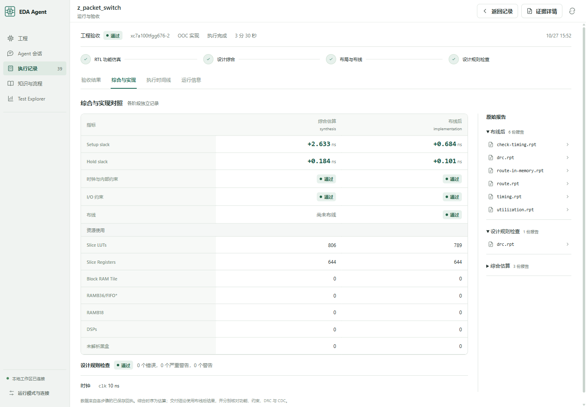
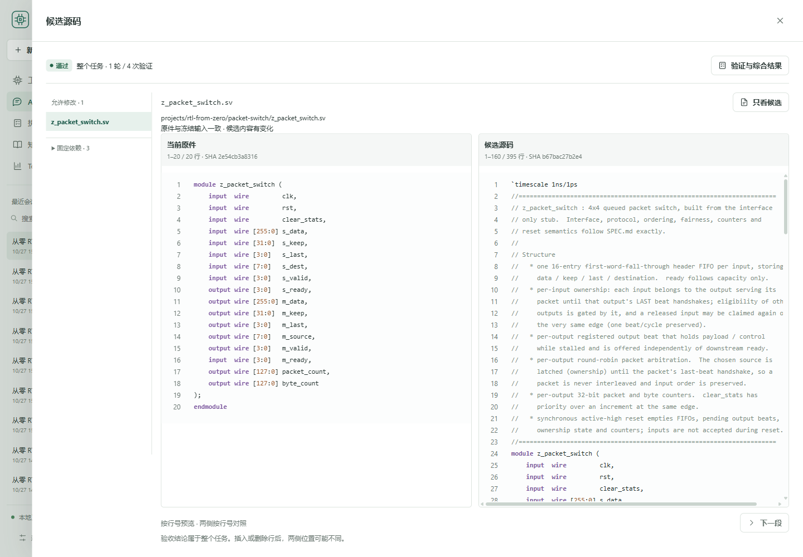

# 两项从零 RTL 的修复与原生闭环

**最终工程验收 2/2，原生 Pi 交付和独立在线评测 2/2 通过。** 继续修复上一批的两个候选，固定规格、testbench、XDC、器件和时钟保持原始哈希。[上一批工程 1/2、原生闭环 0/2](from-zero-rtl-2026-10-27.md)及首次 verifier 0/2 保留原成绩。

| 工程 | 最终功能证据 | Setup / hold | LUT / FF | DRC |
|---|---|---|---|---|
| AXI4 DMA | 128 描述符、84,491 字节、130,590 次协议检查 | +0.313 / +0.135 ns | 331 / 214 | 0 错误、0 严重警告、0 警告 |
| 4×4 包交换机 | 1,860 包、23,055 beat、513,443 次协议检查 | +0.684 / +0.101 ns | 789 / 644 | 0 错误、0 严重警告、0 警告 |

通过版本在 [repaired](../projects/rtl-from-zero/repaired)，原始空壳和首次失败提交仍单独保存。[机器可读成绩](../release/summary-rtl-repair.json)、[两条最终原生会话评测](../release/evaluation-rtl-repair.json)与[310 项离线检查](../release/validation-rtl-repair.json)使用各自分母。

## 修复经过

DMA 沿用上一批 Pi 写出的 325 行设计，本轮由原生 Pi 会话触发固定四阶段 verifier 并取得完整交付。原始数据通路没有再次改写。

交换机原来在 phase 1 排空 watchdog 失败。独立诊断发现，嵌套动态 bit 写得到未知 eligibility 掩码；重命名索引和改成 always_comb 均未解决。隔离副本仅改为静态连续赋值后能完成第一阶段，Pi 随后自己实现同一类修复，原 checker 在 65 周期完成 4 包 / 64 beat 并进入第二阶段。第二个问题是输入 FIFO 弹出 LAST 后，旧输出仍可能背压，新包却提前进入其他输出；需要把输入占用维持到实际 LAST 握手，同时允许同周期释放和再次领取。隔离诊断证明该机制可通过完整 checker，最终候选仍由 Pi 自己修改并重新验收。每轮失败和修改保存在摘要与本机原始记录中。

两份交付 RTL 的功能编辑均来自原生 Pi 工具调用。Codex 提供诊断和审查，另有手工编辑的隔离诊断副本；诊断文件没有复制回 Pi 候选。初始设计来自 CommandCode 的 DeepSeek 阶段；最终会话模型分别为 DMA z-ai/glm-5.3-flash、交换机 z-ai/glm-5.3-flash，仍使用同一 CommandCode 接口。属于有辅助的续修实验，不是单模型盲测。

初版占用修复仍有两个错误：交错释放和领取导致新占用被覆盖，以及组合块先消费旧握手值再更新。固定 verifier 连续拒收两版候选；Pi 最终改为先计算当前握手、所有释放后再执行所有领取，完整四阶段验收通过。

## 框架与界面

- 使用 Pi 原生 active-tool 选择：固定 verifier 会话向模型声明 12 项文件、知识和任务工具，宿主继续执行完整冻结 workflow。真实请求的工具 schema 从 37,804 缩至 7,098 字节；不是总 token 减少 81%。普通探索会话保留完整工具。
- 工作台源码对照展示实际候选和冻结输入；运行中的轮次、调用与预留作为观察进度显示，验收结论仍以封存证据为准。浏览器已实际核对源码、运行进度及综合／布线指标。
- 310 项离线检查通过：282 Node、21 Python、7 ACE；另含流程演示与配置、知识、仓库检查。新增检查覆盖真实 Pi SDK 的工具选择和未封存进度边界，不调用模型或真实 EDA。
- 提供商仍出现断流。保留有界原生重试，实验传输使用 Node 原生完整请求截止；停流与主动取消已用本机服务验证。发布框架的整场会话截止与实验保护边界见 [提供商配置](pi-provider-tuning.md)。
- 同参数的新 stdio MCP 与 CLI 仿真均通过；桌面某次 MCP 启动出现无输出 exit 1。已定位到厂商启动器中与缺失架构环境变量吻合的分支，尚未证实该桌面进程的实际环境，不能据此宣称所有入口均稳定。

## 用量与验收范围

本轮 68 次 CommandCode 请求，**1,322,561 已知 token**，另保留 **6,241,540 token 未知用量额度**。累计已知用量与未知预留占用 27,318,551；另为其他既有服务保留 5,000,000，均在用户 50,000,000 总预算内。其他提供商 API 为 0；外层 Codex 和子 Agent token 不含在此账单。

累计扣除额度：DMA 12/12 轮槽、37/48 次调用；交换机 19/24 轮槽、11/48 次调用。轮槽包含中断生成，调用包含保留的中断额度。重开任务继续累计，未清零；交换机因传输失败明确增加过轮槽上限，固定测试没有放宽。

范围为单时钟 xc7a100tfgg676-2、10 ns 时钟与固定 IO 时序的 OOC。功能刺激、setup/hold、约束、完整布线和 DRC 分别通过；不等于形式证明、板卡引脚集成或实板验证。有限可见测试与人工诊断不计为盲测 pass@1；读取限制属于策略约束，尚无操作系统级读沙箱。

本机全部失败、候选、API 用量和原始报告在 artifacts/rtl-repair-20261027/。复跑命令见 [工程说明](../projects/rtl-from-zero/README.md)。
