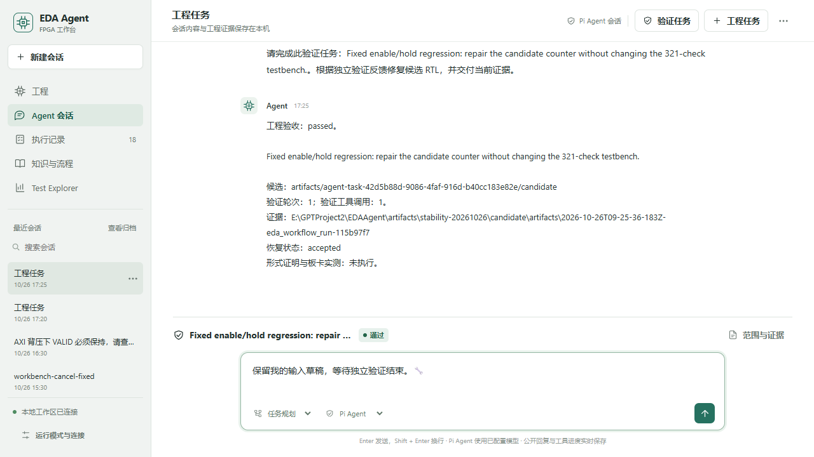

# 原生 Agent 稳定性实测

本轮在独立 Git worktree 中测试原生 Pi、CommandCode、真实 XSim/Vivado 和浏览器工作台，保留每次失败。范围是执行可靠性、验证闭环和证据完整性；没有增加新 Agent 编排器。实测汇总及源码回执见 [发布记录](../release/README.md)。

## 已确认的问题与修复

| 问题 | 调整与验证 |
|---|---|
| Pi 1.3 同时调用 codemode 时 worker 用尽 | 采用上游 [Pi 1.4.0](https://github.com/earendil-works/pi/releases/tag/v1.4.0)；6 路调用从 2 成功、4 拒绝变为全部完成，另验取消后 worker 可复用 |
| 模型截断响应仍进入 verifier | `length` 结束保留为生成失败；仅 Pi 自身后续成功恢复才解除。真实截断测试没有 verifier 调用 |
| checker 判失败但进程正常退出时没有诊断正文 | 从已校验哈希的步骤结果读取日志尾部，限 6 KiB，仅作修复提示；结果被改动时撤回诊断，不改变验收 |
| 手写 schema 校验在 `anyOf` 提前返回 | 改用直接锁定版本的 [TypeBox](https://github.com/sinclairzx81/typebox)，覆盖 required、类型、数值边界和多余参数；优化器原有二次检查保留 |
| 浏览器取消没有映射到 cancelled | 只在实际用户取消且驱动返回 `stopped/user-interrupt` 时确认取消；晚到或被忽略的取消不覆盖真实结果 |
| HTTP 请求与 ACE 子进程按字节块解码中文 | 使用 Node 原生 `setEncoding('utf8')`；中文和补充平面字符跨块回归通过 |
| 不同在线会话合并为一个任务，失败回执丢关联 | 按 session/workflow 对计数；重复评估进入历史，未关联旧记录单列，源码变化显示在案例行 |
| 工作台任务通过后仍显示待核验 | 轮询更新任务条而保留输入草稿；开始修复切换到 Pi 模式；首次准备失败保留表单。真实浏览器任务和受控响应检查覆盖这些状态 |
| 社区 MCP 异步流程提前归还额度 | 实测 `wait=false` 返回时综合仍处于 Queued。代理将综合与实现流程限定为 `wait=true`，使用上游现成等待逻辑；提前返回请求在派发前拒绝 |
| 原 AXI checker 未检查全部内部 VALID 保持 | 新增独立版本的协议 checker，检查 3 个目标 × 5 个通道；正确 RTL 通过，撤回 VALID 的突变失败。历史 checker 和成绩保持原协议 |
| Pi 包只提供 ESM 导出，版本诊断返回 null | 使用 Node 原生 `import.meta.resolve` 读取已安装包元数据；安装后版本回归通过 |
| 历史实机回归入口仍要求恰好 15 个工具 | 实测在 57 个工具时直接失败。改为检查本套回归所需的具体工具，并提前核对历史 DCP；新导出目录实跑 12 项适配器检查通过 |

## 实测覆盖

| 场景 | 观察及验收边界 |
|---|---|
| Counter 失败反馈与修复 | 两轮，固定 321 次检查通过；原始文件保留 |
| AXI 3×3 协议修复 | 实际修改候选 RTL，原生压缩后通过 4,656 个 burst；15 个内部通道均有非零稳定性检查 |
| AXI 完整 OOC workflow | 功能、综合、setup/hold、约束和布线通过；setup +2.135 ns、hold +0.056 ns；CFGBVS-1 与 RTSTAT-10 两条 DRC warning 导致 `review_required`，不能计作完整通过 |
| DMA 编译诊断 | 真实编译失败进入反馈，第二轮通过 717 场景、3,064,242 字节检查与 10,568,464 协议检查；include 树及 checker 固定 |
| PicoRV32 / AES-CTR DMA SoC | 真实固件上报错误触发反馈，修复后通过三种子、42 描述符、26,592 密文字节与 21 次错误恢复；固件和 oracle 固定，完整会话约 255 秒 |
| 三时钟 Ethernet / UDP echo | 30 个 RTL 文件、12,513 行；两种固定时钟比例通过，完整会话两轮、三次 verifier 调用，约 317 秒。补充诊断后的同题复测达到 12 轮模型限制，验收未知；不能宣称诊断补丁提高了成功率或节省 token |
| 已提交边界取消与续跑 | 同一任务和 Pi 会话恢复，累计两轮、两次 verifier 调用；没有重置预算 |
| 正在运行的 DMA 仿真取消 | 所属 cmd、xsim、xsimk 及控制台进程退出；额度可再次取得；任务保持取消/未知验收 |
| 三个并发原生会话 | 三个独立候选均完成；使用同一个 Counter 设计，不能算三个工程；观测 XSim 并发未超过 2 |
| 原生 MCP | Pi codemode 发现并调用本地 MCP preflight，读取社区资源列表；可选 LTspice 缺失未阻止结束。该检查没有启动 EDA |
| 社区 MCP 综合与取消 | 含空格目录创建真实工程；上游同步等待期间额度保持占用。取消时所属 Python/Vivado 综合进程树共 11 个进程退出，额度释放、后端隔离直到重连 |
| 工程 / IP / Block Design | 升级后的主工作区经 traced MCP 代理实跑 33 项检查通过，包括地址分配、生成 wrapper、导出、重开和重建工程，源文件哈希保持一致 |
| 工作台与事件 | 中文会话保存/重载、断线重连、分类分母和陈旧源码标记；1,500 条事件按原顺序重放 |
| 工作台取消与续接 | 在浏览器停止真实 DMA 仿真，4 个所属进程退出；同一 Pi 会话续跑通过 717 场景，累计两轮、两次验证。使用明确的已知正确候选；默认修复提示的另两次尝试分别触及 6 轮模型限制和 180 秒上限，均保留未知验收 |
| 新导出包的 AXI 协议 workflow | 从 README 安装、获取固定 RTL 依赖后实跑：4,656 burst、全部 15 通道检查、综合和布线通过；setup +2.393 ns、hold +0.058 ns；两条 DRC warning 保持 `review_required`。该原始设计与模型修复候选分别计量 |
| 新导出包的 12 项工具回归 | 混合 VHDL/SystemVerilog、include/宏/参数/plusargs、预期 Fatal 负控、Tcl 查询按数据传递、综合布线、CDC 报告和网表路径/对象查询均符合预期。后两类读取保留的 Ethernet / Crypto DCP，不计为新源设计通过 |

HTTP 200 也出现过没有 `finish_reason` 和用量回执的中断流。原生 SDK 拒绝该次运行，verifier 没有执行。保留此失败，不能把后续重新试验记为原尝试成功。

工作台直接创建候选并启动真实 Pi 任务后的界面；下方输入框保留草稿，任务条使用宿主验收。

## 复现与计量

`npm run validate:agent` 关闭模型 API，运行假 EDA、本机进程、真实 Pi SDK 的内存响应和 MCP 控制面检查。模型/EDA 实测须另外授权并配置环境。全新导出目录从零安装后为 **266 Node + 21 Python + 7 ACE = 294 项全通过**，另通过 verifier 演示、配置、知识与仓库检查；这些是软件检查，不能计作 RTL 任务。[验收回执](../release/validation-stability.json)与[在线摘要](../release/evaluation-stability.json)保留各自来源。

加强后的 AXI checker 位于 [tb_axi_fabric_protocol.sv](../projects/hard-bench/axi-fabric/tb_axi_fabric_protocol.sv)，对应 [独立 workflow](../examples/workflows/axi-fabric-protocol-ooc.json)。它与原 `online-axi` 协议分开；更换 checker 后必须另建运行。VALID 与 payload 保持规则参考 [ARM IHI 0022H A3.2.1](https://developer.arm.com/-/media/Arm%20Developer%20Community/PDF/IHI0022H_amba_axi_protocol_spec.pdf)。

社区代理约束 `run_synthesis`、`run_implementation` 的等待参数，不增加自己的后台 job 调度器。上游 `generate_bitstream` 始终同步且没有 `wait` 参数，保持原始 schema。原始 `run_tcl` 是不透明脚本接口；启动异步工程时仍必须显式 `wait_on_run` 等待，单次 RPC 租约不能跟踪任意后台 Tcl 子任务。

CommandCode 请求模型为 `deepseek/deepseek-v4-flash`，服务端实际回执为 `deepseek/deepseek-v4.1-flash`。预算 50,000,000 token 是上限；实测按请求记录已知用量、无终态回执的保守预留和初始探针，缓存命中已经包含在 prompt token 内，不重复相加。SDK 零价格元数据不表示免费；账单未验收。实验计量器保留在本地，不成为新的生产编排层。

本轮 114 个计量请求加 1 个初始探针，已知用量 **3,598,843 token**；四个缺失完整用量回执的请求保留 **808,488 token** 预算预留。没有未结束请求。外层 Codex token 单独计量，这里不将缺失值记成零。

这些场景使用可见 checker，部分故意先产生基线失败；没有随机抽题、盲测 pass@1、形式证明或板卡实测分数。历史测试不因源码升级自动变成当前版本通过。原始会话、请求内容、凭据和大型 EDA 产物留在本地，公开摘要仅包含必要指标与证据哈希。

外层 Codex 另从本地会话计数读取：截至 10:35:56 UTC，窗口累计 52,359,325 token，其中 51,280,384 是已包含在输入内的缓存 token。此前 50,000,000 token 闸仅覆盖 CommandCode；若按二者合计解释，则已超过用户预算，因此停止扩展测试并提前收尾，未做到原定五小时。该计数不是账单，收尾新增用量以最终本地快照为准。
