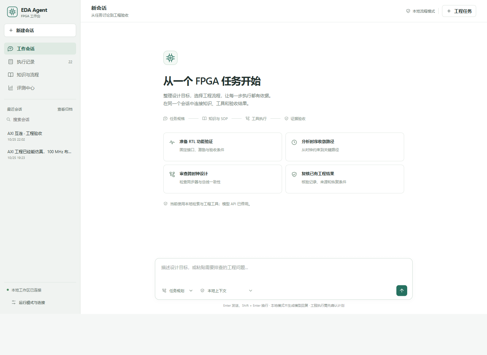

# 会话工作台验收

v0.7 按本机 ERP Agent 的会话、任务工作区与运行详情核对交互和状态合同。验收包括界面操作、持久状态与证据关联；真实模型质量另行评测。其他模型 API 当前停用。

## 对照范围

只读检查 `erp-harness-refactor/desktop/src/renderer/App.tsx`、`features/conversation/ConversationPane.tsx`、`features/business/BusinessWorkspace.tsx` 与 `src/shared/protocol.ts`。工作区含未提交修改，引用针对当时读到的源码。

| ERP 机制 | EDA 应有的行为 | 验收要点 |
|---|---|---|
| Session → Message → Business → Run 独立身份 | 会话拥有消息和工程任务；每个任务关联其执行记录 | 切换会话不会串入其他任务、消息或取消按钮 |
| 会话栏、任务工作区、可收起会话面板 | 以会话和工程目标为入口；运行状态、证据和上下文按需展开 | 1280 px 桌面及窄屏可完成主流程；主操作可键盘访问 |
| 公开消息流带 session/run/sequence | 活动、公开文本与工具事件有来源；重连后可恢复观察 | 刷新不重复执行；历史选择保持原位 |
| 业务阶段与结果核验分别显示 | 执行完成与工程验收独立呈现 | `completed` 不替代 `passed`；缺证据为 unknown；DRC warning 保持待审查 |
| 运行和中断状态持久化 | 取消先显示请求，待执行器终态；重启保留任务与中断原因 | 不自动重放 EDA；恢复前保留 workflow 检查 |
| Trace 按需详情和首个异常定位 | 从任务进入步骤、工具与原始证据；长日志不阻塞主界面 | 缺失或损坏证据给出明确错误；不能读取项目外路径 |
| 事实回读不改历史运行 | 同时展示记录时结果、当前完整性及适用版本 | 源码变化不改写旧成绩；当前复用条件失配明确标记 |

## 必须核对的流程

1. 创建会话，输入 FPGA 目标，读取阶段规则、完整 SOP、来源与工具合同；重新加载后仍可定位。
2. 将目标关联任务，审阅固定输入、步骤、验收与执行影响；启动已声明的流程，查看活动和终态。
3. 在运行时切换会话，再返回；任务与取消操作仍指向原执行。取消后不会显示伪成功。
4. 查看任务结果，分别读取功能、综合、setup、hold、约束、布线、DRC、CDC 与证据完整性。
5. 从历史任务查看记录时结果，再查看当前源码匹配状态；可读取原证据且不自动发起复跑。
6. 按离线软件、RAG、证据、真实 EDA 和真实 Agent 任务查看评测，分母与未运行项独立展示。
7. 模型 API 禁用时，模型发送入口有明确状态；直接请求也必须由宿主拒绝，初始化不得读取模型凭据。
8. 界面空态、加载、网络失败、任务失败和中断状态可解释且有可用后续动作；桌面与窄屏无横向内容丢失。

## 本轮记录

本轮完成三名子 Agent 的前端、后端与独立审查协作，并由主 Agent 进行实际浏览器交互和完整离线验收。

| 检查 | 状态 | 证据 |
|---|---|---|
| ERP 前端与协议源码对照 | 已完成 | 上述四处源码；EDA v0.6 为检索消息存储与内存 job，缺少完整会话运行合同 |
| 会话作用域、任务保存与进程重启 | 6/6 独立检查通过 | [验收测试](../tests/workbench-acceptance.test.mjs)：跨会话计划拒绝、单次执行、事件隔离、保存后恢复、死所有者中断、禁用模型、journal 崩溃窗口与 SSE 断线游标；多个断言按 6 个测试计数 |
| 任务运行、恢复与公开流 | 7/7 后端检查通过 | [运行测试](../tests/workbench-runtime.test.mjs)：归档、计划漂移、跨服务会话租约、取消请求与终态、晚到取消、恢复前核验与来源链、假 Pi 公开文本聚合 |
| Pi 会话适配与禁用状态检查 | 宿主入口已核对 | 直连 `/api/agent` 返回 403；adapter 未初始化，消息/job/凭据目录未创建。SDK 生命周期由另一组假 SDK 测试验收 |
| 运行证据文件预览 | 6/6 独立检查通过 | [预览测试](../tests/workbench-artifacts.test.mjs)：目录/文件范围、workflow 步骤回执、真实路径越界、敏感内容遮盖、中文分页、原件哈希、大小与格式错误、UTF-16 日志、实际 HTTP 接线 |
| 浏览器会话管理与键盘 | 已完成 | 独立新建会话完成重命名、Tab/Enter 保存和归档、恢复、重载、归档列表、Escape 回焦；测试会话最后归档保留 |
| 浏览器错误状态与模型停用 | 已完成 | 空名称保存改为中文内联提示，弹窗保留、焦点回输入框；复测通过。Pi 模式选项显示停用且不可选择 |
| 主流程浏览器验收 | 已完成 | 问题检索、刷新持久化、重命名、计划预览、真实本地工具执行、验收页、历史 AXI、恢复条件阻断及报告预览；桌面 1440×1050、窄屏 390×844 |
| 假 Agent 浏览器验收 | 已完成 | 隔离临时工作区，公开文字增量、工具事件、答复保存、停止；不加载真实 Pi 或调用提供商 |
| 离线机制回归 | 136 Node + 21 Python 通过 | [发布回执](../release/README.md) 与 CI 保留计数、日志及源码哈希；前述独立测试包含在这 136 项内，不重复累加 |
| 检索回归 | 24/24 Hit@5 | 24 条可见问题；3 条无关问题均无命中，不是盲测答案分数 |

[AXI 历史工程验收截图](media/workbench-axi.png) · [分类评测截图](media/workbench-evaluations.png)

独立浏览器截图保存在本机 `output/playwright/eda-v07-audit-archive-list.png`、`eda-v07-audit-dialog-validation.png`。独立检查期间仅修改测试会话，保留原有 AXI 会话。发现并修复了 journal 指针落后导致事件重复、SSE 续传忽略 Last-Event-ID、名称校验失败关闭弹窗三项问题；失败反例保留在对应检查中。

另外只读核对了真实 AXI 历史目录的六份可预览文件。`drc-report.result.json` 为 2,626 bytes，原件 SHA-256 为 `442a73fb814d321ebc4003153746cd8e38448d8a207c828293312dd2ebb9e980`，成功读取。该检查验证历史报告访问，不计作重新执行 Vivado。

## 结果边界

历史 11 组成绩和 v0.6 的真实工程结果保留。AXI 真实流程记录为 `review_required`：功能、综合和物理检查已有证据，DRC 含 2 个 warning；不能表述为全部工程验收通过。Counter 的 321 次功能检查也不等于大型 FPGA 或模型能力分数。

离线检查可验证会话合同、重启、取消、消息和 trace 关联，不能给出真实 Agent 多轮任务成功率。提供商调用为 0；外层 Codex token 未计量。

取消是合作式请求：界面先显示取消请求，收到执行器终态后才显示最终状态。Pi SDK 初始化尚未返回时，无法由界面立即终止该 Promise；会等待后端退出。关闭页面不代表任务已经取消。

证据预览接受运行目录中的日志、报告和指定结果 JSON，排除输入快照、prompt、原始会话事件与凭据文件。文本最大 8 MiB、JSON 最大 1 MiB，每页最多 64 KiB。JSON 中的敏感值和推理内容会遮盖；用量数字保留。预览展示原件 SHA-256，字节分页基于遮盖后的 UTF-8；原文件保持不变。预览不是工程验收结论。

已有入口：[ERP 机制对照](erp-parity-and-workbench.md)、[评测协议](evaluation.md)、[Agent 工作流与 trace 合同](agent-workflow-and-trace-contract.md)、[协作与 trace 文档](agent-framework-and-traces.md)。
