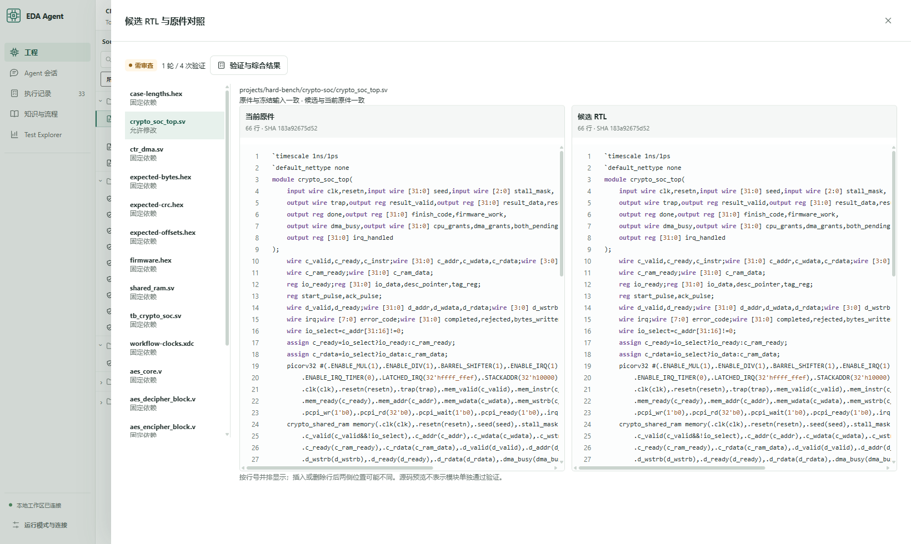
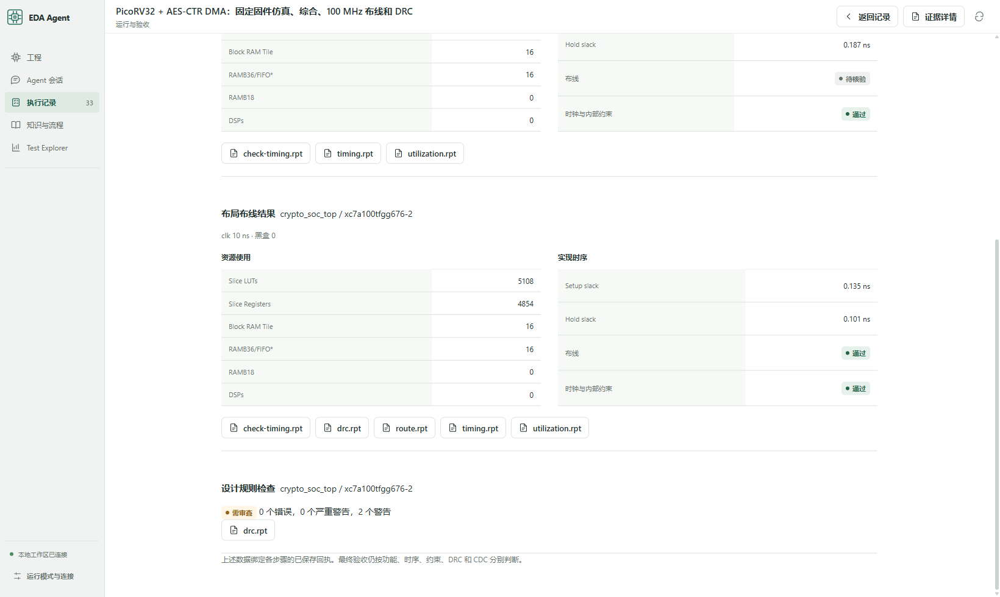

# 从会话查看 RTL 与综合结果

后续完整复测已完成：[A7-100T 8/8 工程验收](a7-eight-projects.md)。下文的早期失败记录保留原运行条件。

会话中的 **查看候选 RTL** 打开原件与候选的源码对照，显示行号、SHA-256、可修改 RTL 和固定依赖。工程页的 **Agent 候选** 关联同一验收任务；候选结果不会替代原工程的验收状态。

候选视图按行号并排展示，可翻页查看长文件。原件发生变化会明确显示与冻结输入不一致；路径只来自已核验的任务合同，拒绝任意文件路径和符号链接。两侧不同不代表设计改进，功能仍由固定 checker 判断。

打开 **验证与综合结果 → 综合与实现**，查看每一步的 LUT、寄存器、BRAM、时钟、黑盒、setup/hold 和约束状态，再点击原生 `.rpt` 报告。数据来自经过完整性检查的 workflow 结果；综合估算与布线时序分别展示。未知、失败及待审查继续保留。

完整工程规格：

- [PicoRV32 + AES-CTR DMA](../examples/workflows/crypto-soc-full.json)：固定固件及三种子 checker、综合、100 MHz 布线、DRC。
- [三时钟 GMII UDP](../examples/workflows/ethernet-cdc-full.json)：两种时钟比 checker、综合、100/125 MHz 布线、DRC；CDC 仍需要独立审查。

这些规格复用仓库已有工程与固定依赖。测试数据路径遵循现有工程准备方式，迁移工作区后须先准备向量及固件并核对输入。`plan` 静态检查；`run` 启动真实 EDA。没有板卡或形式签核结论。

```powershell
npm run workbench
npm run workflow -- plan examples/workflows/crypto-soc-full.json
```

CommandCode 预算仅覆盖该 API，沿用原请求台账和缺失回执预留。外层 Codex 单独计量。公开仓库默认关闭模型 API，浏览源码和报告无需模型调用。

## 本机实测

结果关联修复后，两套完整工程各复跑一次；候选合同、原件哈希与新产物均核验有效。候选引用原件中的测试数据时，其结果不会写入原工程的验收矩阵。修复前的运行保留为历史记录。

| 工程 | RTL 规模 | 实测结果 |
|---|---|---|
| PicoRV32 + AES-CTR DMA | 10 文件 / 5,728 行 | 三种子、42 描述符、26,592 密文字节和 21 次错误恢复通过；综合、布线通过；setup +0.135 ns、hold +0.101 ns；DRC 两条 warning，整体待审查 |
| 三时钟 GMII UDP | 30 文件 / 12,513 行 | 两种时钟比仿真、综合和布线完成；setup −0.078 ns，hold +0.072 ns；一项输入约束待审查，整体失败 |

这些是已知实现的完整流程验收，每个任务固定一轮；没有在本轮修复以太网时序，也没有放宽约束。在线 Agent 计分入口保留两个未完全通过的任务，不能算成 2/2 成功。布线后的 SoC 使用 5,108 LUT、4,854 寄存器、16 BRAM tile；Ethernet 使用 1,896 LUT、2,964 寄存器、8 BRAM tile。

完整离线验收 **270 Node + 21 Python + 7 ACE = 298 项通过，零跳过**。浏览器实际核对候选源码、长文件翻页、原生报告和任务结束后的工程页刷新；390 px 页面无整体横向溢出。

本次补充测试新增 **9 次 CommandCode 请求 / 258,224 已知 token**。累计 123 次计量请求和 1 次探针，共 **3,857,067 已知 token**；另保留 **808,488 token** 的缺失回执预留。无未结束请求，未调用其他模型提供商。

详见 [工程和预算回执](../release/evaluation-workbench-visible.json)、[软件验收回执](../release/validation-workbench-visible.json)。




