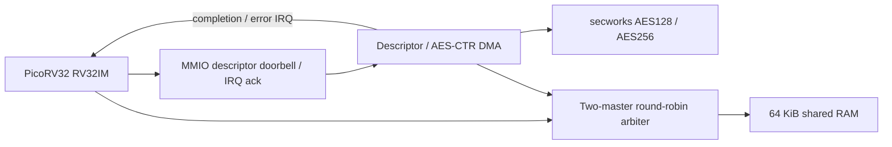

**主回归、密文损坏负控、保留 RAM 的暖复位补测及 100 MHz 布局布线均通过。** 加强后的主回归耗时 255.34 秒，完成 11,919,085 个周期；CPU/DMA 同时 pending 161,407 周期、总线授权切换 28,058 次、DMA 活跃时 CPU 授权 27,283 次、固件并行工作 355 轮。证据和精确口径见 [result.json](result.json)。

CPU 驱动的 AES-CTR DMA SoC：PicoRV32 RV32IM 真正运行 Zig 编译的 C 固件，通过 MMIO 提交 RAM 中的链式描述符；DMA 经共享 RAM 读取密钥、128 位计数器和输入，将密文写回，再发 completion/error IRQ。CPU 与 DMA 通过轮转仲裁共享 64 KiB RAM，包含实际读写停顿。



描述符是 8 个小端 32 位字：`src, dst, len, key_ptr, IV_ptr, flags, next, cookie`；`flags[0]` 选择 256 位密钥，0 为 128 位。地址需 4 字节对齐，长度允许 1–4096 字节，末尾使用 byte strobe。计数器按大端 128 位递增；每次提交最多完成 16 个描述符，检测循环。忙时再次提交会被忽略并计数。准确 MMIO 地址见 `crypto_soc_top.sv`。

三组数据种子和共享内存停顿配置，验证 42 个正确描述符、26,592 字节密文；长度包含 4093、1、15、16、17、257、33 字节，并包含计数器回绕。Python cryptography 的 AES-CTR 给出独立完整输出参考，CPU 用 CRC32 检查密文和原始输入，TB 再逐字节比较密文。固件与 TB 都检查输出前后哨兵。

七类错误分别是未对齐描述符、零长度、33 位地址溢出、非法 next、部分地址重叠、非法 flags、自环超过 16 次上限。每次错误之后，CPU 都提交含 128/256 位两种密钥的正确链验证恢复。记录实际同时 pending 周期、总线授权切换、DMA 活跃时 CPU 授权及固件独立 RAM/CRC 工作轮数。

独立 TB 观察器从有效 doorbell 到 IRQ 统计真实 DMA 写握手与 byte strobes，忽略忙时重复提交。每个种子的前六类错误实际写入均为 0，自环场景准确写入 512 字节 / 128 个握手，并将最终 32 字节密文与独立参考逐字节比较。此项强化复跑保留了旧通过回执，不增加项目或用例数量。

主回归在传输中复位并重新加载启动映像；`warm` 补测在传输中复位后保留 RAM，由固件自行重新初始化和完成全套单种子验证。该补测不增加主回归的独立用例数量。负控只修改 DMA 写出的一个 RAM 密文 bit，必须由 CPU 固件报告 `badc0000`，且没有通过标记。

```powershell
python projects/hard-bench/crypto-soc/build.py
python projects/hard-bench/crypto-soc/run.py
python projects/hard-bench/crypto-soc/run.py negative
python projects/hard-bench/crypto-soc/run.py warm
```

来源固定于 `manifest.json`：[PicoRV32](https://github.com/YosysHQ/picorv32)（ISC）、[secworks/aes](https://github.com/secworks/aes)（BSD-2-Clause），上游文件保持不变。新写的逻辑是 SoC、仲裁器、描述符 DMA、固件和验证环境。采用的 10 个模块定义合计 3,954 行模块正文，去注释空行为 3,377 行；未将未使用的 CPU 总线包装和 AES 解密路径计入。

Vivado 2020.2 在 `xc7a100tfgg676-2` 完成 100 MHz、2 ns IO delay 的 OOC 布局布线，耗时 163.08 秒：setup WNS **+0.518 ns**，hold **+0.096 ns**，物理 Slice LUT **5,110**、FF **4,866**、RAMB36 **16**、DSP **0**；9,084 条可布线网络全部布通，无 routing error。资源包含总线统计寄存器。构建收据中的 `lut_cells=5692` 是 primitive 数量，资源比较应使用 utilization 报告的物理 Slice LUT 数。

最新原始日志：主回归 (local/optional evidence; see results/catalog.json)、负控 (local/optional evidence; see results/catalog.json)、暖复位 (local/optional evidence; see results/catalog.json)、时序 (local/optional evidence; see results/catalog.json)、资源 (local/optional evidence; see results/catalog.json)。负控耗时 68.05 秒，CPU 检出单 bit 密文损坏；暖复位补测耗时 78.75 秒。

采用 native 请求/响应总线和 MMIO，没有宣称 AXI 兼容；没有缓存、操作系统、认证加密或板卡验证。OOC 接口位置及板级时钟/IO 条件未签核。
