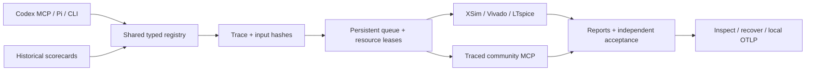

# Native EDA Agent

A local FPGA/EDA agent built around Pi, typed tools, reproducible evidence and MCP. Codex or another MCP client can drive the same tools directly. Model-provider calls are disabled by default; local tools and offline tests need no model API key.

**48 native interfaces**, including 28 focused contracts over shared executors and 4 historical-results tools. The optional community Vivado backend provides **45 tools and 11 prompts**, including project, IP and Block Design operations. These counts describe interfaces, not independent engines or design achievements.

Tool schemas (local/optional evidence; see results/catalog.json) · Architecture and workflow (local/optional evidence; see results/catalog.json) · Historical results (local/optional evidence; see results/catalog.json) · Trace collaboration history (local/optional evidence; see results/catalog.json) · Release notes (local/optional evidence; see results/catalog.json)

## Quick start

Windows is the supported EDA execution environment, validated with Vivado/XSim 2020.2. Use Node.js 24 and Python 3.12 or newer. Vivado and LTspice must be installed separately; no commercial software or license is bundled.

```powershell
npm ci --ignore-scripts
pwsh scripts/bootstrap-python.ps1
npm run setup:local
npm run validate:agent
```

Setup creates local Codex/Pi MCP configuration with your checkout path. Existing configuration is preserved; `node scripts/setup-local.mjs --replace` backs it up before replacement. Reconnect the MCP client afterwards. Set `EDA_VIVADO_BIN` to your installed Vivado `bin` directory before EDA execution; the current fallback is `E:\Xilinx\Vivado\2020.2\bin`.

The offline acceptance uses fake EDA backends, real local subprocesses, the MCP control plane and a loopback OTLP receiver. It does not launch Vivado, LTspice or model sessions. Run receipts and source hashes are written to a new `artifacts/agent-offline-*` directory.

## Use the tools

```powershell
npm run tools
node scripts/results.mjs list
node scripts/results.mjs verify hard-projects-3
node scripts/results.mjs compare verilogeval-24-original verilogeval-24-extended
node scripts/benchmark.mjs plan --ids counter
```

The last comparison is rejected as incomparable because the watchdog changed. To execute a native tool, save its arguments to JSON and call `node scripts/eda-tool.mjs TOOL arguments.json`. For example:

```json
{"checkpoint":"artifacts/my-run/routed.dcp"}
```

Passing this file to `eda_vivado_report_cdc` starts Vivado and generates CDC evidence in a fresh run directory. Use `eda_trace_inspect` to check the receipt. `eda_vivado_optimize` also starts Vivado in **plan** mode; use its documented recovery-check interface for offline inspection.

In Codex/Pi: preflight → select fixed inputs and acceptance → simulate → synthesize → implement → inspect timing/CDC/DRC → inspect trace. A completed tool call is not design signoff. Setup/hold, functionality, CDC, formal proof and board validation remain separate judgments.



## Retained results

These are local historical results, imported from original receipts. They were not rerun during the framework release. No combined score is calculated across overlapping tasks, projects and software checks.

| Scope | Retained result |
|---|---|
| Initial VerilogEval selection | 7/8 |
| Separate 24-task selection, original watchdog | 20/24 |
| Same 24 RTL candidates, extended watchdog on three cases | 23/24 |
| 1024-point FFT | 16 frames / 16,384 bins; 100 MHz OOC implementation |
| SoC / DMA / UDP / AES | 4/4 functional and OOC implementation |
| AXI 3×3 / Ethernet CDC / RV32IM AES DMA | 3/3 functional, negative controls and OOC implementation |
| Frozen 61-case campaign | 51 PASS, 1 FAIL, 6 TIMEOUT, 2 expected failures, 1 expected timeout |
| Native tool / Workbench integration | 12/12 and 33/33 checks |
| AXI optimizer smoke | 2 candidates; measured WNS gain **0 ns**, winner rechecked |

The Ethernet design retains **34 CDC warnings**. All physical design results are out-of-context, with no board testing or formal CDC proof. These are visible-test integration exercises with pinned public IP, not blind pass@1 scores or official FPL leaderboard reproduction.

11 machine-readable scorecards (local/optional evidence; see results/catalog.json) include original artifact hashes and hashes of sanitized public evidence. Missing local originals are reported as unavailable. Hash verification proves file integrity, not independent reproduction.

## Larger examples and optional integrations

`projects/fft-spectrum`, `projects/system-bench` and `projects/hard-bench` contain source examples and fixed verification materials. Fetch their pinned public RTL sources with `node scripts/fetch-example-upstreams.mjs`. Inspect historical absolute-path relocation using `node scripts/relocate-examples.mjs`, then apply with `--apply` if needed; backups are retained and new runs record changed input hashes. Each project documents its stimulus, accepted scope and limitations. Some firmware-generation steps require a separate RISC-V toolchain.

The public package includes the community MCP backend and the RouteAgents pure recipe router with their licenses. AMD Ross binaries/skills, LTspice bridge, commercial tools, private model configuration, DCPs and waveforms are optional local dependencies. Synopsys tooling is a separate project and requires licensed tools for commercial execution.

Trace export defaults to a local OTLP JSON file. Upload requires an explicit receiver command; no cloud collector is configured. See trace delivery and recovery (local/optional evidence; see results/catalog.json).

Original framework code: MIT (local/optional evidence; see results/catalog.json). Dependencies and IP: third-party notices (local/optional evidence; see results/catalog.json). Contributions should include fixed acceptance, failure evidence and the relevant offline checks; preserve historical scores and never infer a passing design from a successful subprocess exit.
